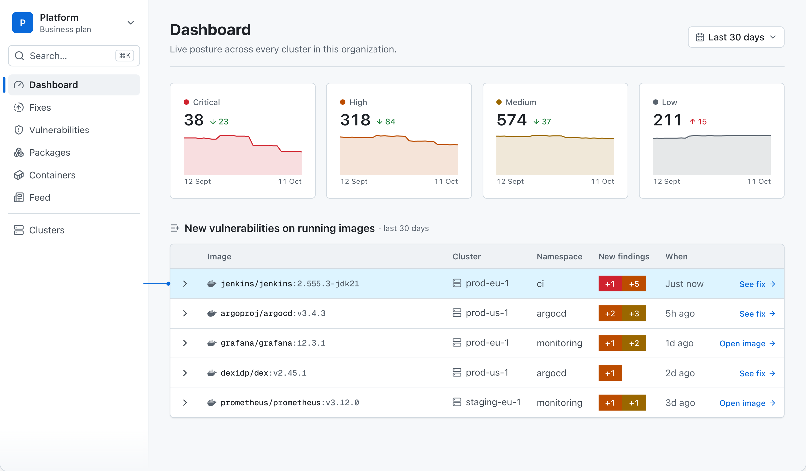
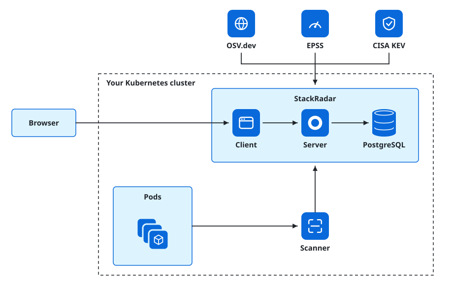
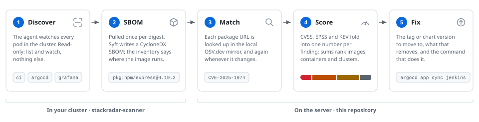

<h1>
   StackRadar
</h1>

**The vulnerabilities on the images actually running in your Kubernetes
cluster, ranked by what to fix first, with the upgrade that fixes them.**
Open source under AGPL-3.0. Self-host it with one `helm install`, or use
the hosted version at [app.stackradar.io](https://app.stackradar.io).

[](https://github.com/lockdep/stackradar/releases/latest)
[](https://github.com/lockdep/stackradar/actions/workflows/ci-test.yaml)
[](LICENSE)
[](https://artifacthub.io/packages/helm/lockdep/stackradar)
[](https://github.com/lockdep/stackradar/stargazers)

**[Try the live demo](https://demo.stackradar.io/demo/enter)** · no account
needed · **[Install in one command](#quickstart)** · [Documentation](docs/) · [Cloud pricing](https://stackradar.io/pricing)

A scanner tells you your cluster has four thousand CVEs. StackRadar tells
you which of them are on images that are running right now, which of those
are being exploited in the wild, and which chart version or image tag makes
them go away. When a new advisory is published, the dashboard already knows
which pods run it, without pulling or scanning anything again.



## Why StackRadar

* **It scans what runs, once.** One read-only agent watches the pods of
  the cluster it runs in, pulls each image once per digest and writes its
  SBOM with [Syft](https://github.com/anchore/syft). No scan Job per
  workload, no report objects in etcd, no vulnerability database
  downloaded by the agent. An image in five namespaces is one pull, one
  SBOM and one matching pass.
* **It re-matches instead of re-scanning.** The server keeps its own
  mirror of [OSV.dev](https://osv.dev), [EPSS](https://www.first.org/epss/)
  and the [CISA KEV catalogue](https://www.cisa.gov/known-exploited-vulnerabilities-catalog),
  syncs OSV hourly and EPSS and KEV daily, and matches every stored SBOM
  against the mirror again whenever it changes. A new advisory lands on your running images without an image
  being pulled, and nothing is sent anywhere to be scored.
* **It ranks by exploitability, not by CVSS alone.** The Radar Score folds
  CVSS, EPSS and KEV into one number per finding and sums them per image,
  container, release and cluster. The top of every list is what to fix
  first, and a base-image finding is told apart from one in your own code.
* **It knows how the image got there.** The Helm release that packaged a
  workload and the Argo CD application that delivers it are on the page,
  so the fix is a chart version and a `helm`, `argocd` or `kubectl`
  command, not a CVE id.

If you need configuration audit, RBAC assessment or CIS benchmarks,
[Trivy Operator](https://github.com/aquasecurity/trivy-operator) does
those and StackRadar does not; the two run side by side without conflict.
[stackradar.io/compare/trivy-operator](https://stackradar.io/compare/trivy-operator)
is the longer comparison.

## What you get

### A new advisory on a running image, and the upgrade that clears it


Every image that picked up a critical or high finding, what arrived
(package, installed version, fixed version, advisory), how it arrived, the
upgrade that removes it and how much else that upgrade removes, and every
container running the image with the chart that put it there.

### The findings that add the most risk, right now


Ranked by contribution to the Radar Score rather than by severity label.
Each row says whether the finding is in the base image or the application
layer, whether a fix exists, and how many images and containers carry it.

### What changed, day by day


A feed of changes, not inventory: advisories that landed on a running
image, containers that moved between digests with the finding delta
between them, and containers that came and went. New critical and KEV
findings can also go to a Slack webhook.

### The whole fleet, worst first


Every finding across every cluster, filtered by severity, known
exploitation, cluster, namespace or image, with base-image findings in or
out of the count. Containers, images and packages have the same list from
their own angle.

### And the parts a self-hosted tool needs

* **Sign-in:** local username and password with a bootstrap admin, any
  OpenID Connect provider, GitHub and Google.
* **CycloneDX in and out:** upload an SBOM by hand with `curl`, download
  the stored SBOM of any image.
* **End-of-life verdicts** for base images, so a fix that cannot exist is
  not on the list.
* **One Postgres, migrations on boot, no telemetry.** The images never
  phone home; adoption is counted in pulls, issues and
  [ADOPTERS.md](ADOPTERS.md).

## How it works

<picture>
  <source media="(prefers-color-scheme: dark)" srcset="docs/images/how-it-works-dark.svg">
  
</picture>

Three components, two of them in this repository. The **scanner** watches
the pods of the cluster it runs in and reports one SBOM per image digest
plus the full inventory over an API key scoped to that cluster. The
**server** holds the SBOMs, mirrors the advisory feeds locally, matches
components against them by package URL, re-matches when the mirror changes,
and ranks every finding and every rollup. The **client** is the dashboard
and the only thing a browser talks to; it owns sign-in and proxies the API
with an internal service key. One PostgreSQL database carries both.

<picture>
  <source media="(prefers-color-scheme: dark)" srcset="docs/images/one-image-dark.svg">
  
</picture>

The image is the unit of identity, not the workload: a workload does not
have findings, it references an image that does. The score has two layers,
a 0–100 risk per finding that is a pure function of the advisory, and an
unbounded sum of those per image, container, release and cluster. The full
picture, with the trust boundaries, the data model and the decisions behind
them, is [docs/ARCHITECTURE.md](docs/ARCHITECTURE.md) and the ADRs in
[docs/adr/](docs/adr/).

## Quickstart

### Helm

One command on any Kubernetes 1.25+ cluster with Helm 3.8+. No values
file, no database to bring, no second command for the scanner:

```sh
helm install stackradar oci://ghcr.io/lockdep/helm-charts/stackradar \
  --create-namespace -n stackradar
kubectl -n stackradar port-forward svc/stackradar-client 3000:3000
```

Open <http://localhost:3000>, log in as `admin@stackradar.local` with the
password `admin`, and change it when asked. Your cluster's images are
already being scanned; findings appear once the vulnerability mirror has
bootstrapped (minutes, depending on your connection; the UI says so until
then). On a laptop cluster (kind, minikube, Docker Desktop) add
`-f https://raw.githubusercontent.com/lockdep/helm-charts/main/charts/stackradar/values-quickstart.yaml`
for trimmed resources and a two-minute, Alpine-only mirror.

> [!WARNING]
> The default install uses a bundled Postgres and **public fixture
> credentials**, and `helm install` prints a warning naming each one still
> in effect. Set your own before you rely on it;
> [docs/self-hosting/helm.md](docs/self-hosting/helm.md) is the walkthrough.

### Docker Compose

The try-out without a cluster. It cannot run the scanner, so it proves the
platform with an SBOM you upload yourself:

```sh
curl -LO https://raw.githubusercontent.com/lockdep/stackradar/main/deploy/compose/docker-compose.yml
docker compose up -d
```

Open <http://localhost:3000> and log in with the same default credentials.
[docs/self-hosting/docker-compose.md](docs/self-hosting/docker-compose.md)
has the two `curl` lines that upload an SBOM, and the same warning about
fixture secrets.

### Scan a cluster from your laptop

No install, no account: [`stackradar scan`](https://github.com/lockdep/stackradar-cli)
answers the same question for a cluster you have `kubectl` access to and
prints the report in your terminal.

## Community Edition vs StackRadar Cloud

One codebase, two configurations. The cloud and a self-hosted install run
the same images; `STACKRADAR_EDITION=community` is the default, and the
cloud opts in. There is no fork and no feature flag you cannot read in
[`server/src/edition.ts`](server/src/edition.ts).

| | Community Edition | StackRadar Cloud |
|:--|:--|:--|
| Where it runs | Your cluster (`helm install stackradar`), or a laptop (Compose) | app.stackradar.io; you install only the scanner, with a key from the dashboard |
| Clusters | One: the cluster it runs in | Many in one dashboard, across networks and accounts |
| Postgres and the vulnerability mirror | You run them (a bundled Postgres by default) | We do |
| Sign-in | Local username/password, any OIDC provider, GitHub, Google | GitHub, Google and OIDC; enterprise SSO (SAML, SCIM, enforced SSO) is planned for the cloud only |
| Alerts | One Slack webhook per organisation | Email and Slack, with a weekly digest |
| Help | [Discussions](https://github.com/lockdep/stackradar/discussions) and issues | Support |
| Price | Free. AGPL-3.0 | Free for one cluster; Pro and Business from $59 and $199 a month. See [stackradar.io/pricing](https://stackradar.io/pricing) |

Everything that is only sold on the cloud lives under
[`server/src/cloud/`](server/src/cloud/) and
[`client/src/cloud/`](client/src/cloud/), under its own licence (below),
and is mounted by one line when the edition is cloud. CI
([cloud-boundary.yaml](.github/workflows/cloud-boundary.yaml)) keeps the
boundary mechanical.

## Security

* **The agent is read-only.** Its ClusterRole is `list` and `watch` on
  pods plus metadata-only `get` on their controllers; no `create`,
  `update`, `delete` or `patch` on anything. What leaves the cluster is an
  allowlist, documented line by line in the
  [scanner README](https://github.com/lockdep/stackradar-scanner#what-leaves-your-cluster).
* **No telemetry.** Neither image phones home. The only outbound traffic
  from a self-hosted install is the advisory mirror syncs.
* **Scanner keys are cluster-scoped.** An SBOM, its findings and its
  inventory belong to exactly one cluster; nothing derived from an upload
  is ever shared across clusters
  ([ADR 0006](docs/adr/0006-images-are-cluster-scoped.md)).
* **Signed, attested, multi-arch releases.** `ghcr.io/lockdep/stackradar-server`
  and `ghcr.io/lockdep/stackradar-client` ship together under one version
  for `linux/amd64` and `linux/arm64`, signed with cosign keyless, with
  SLSA provenance and SBOM attestations, and the chart pins them by digest.
  [RELEASING.md](RELEASING.md) has the `cosign verify` commands, the tag
  policy and the pin recommendations. CodeQL and Dependabot run on every
  change, and [OpenSSF Scorecard](https://scorecard.dev/viewer/?uri=github.com/lockdep/stackradar)
  scores the repository's own supply chain on every merge.

Report a vulnerability privately through
[GitHub's private reporting](https://github.com/lockdep/stackradar/security/advisories/new)
or to security@stackradar.io; [SECURITY.md](SECURITY.md) has the scope,
the response time and the supported versions.

## Documentation

[docs/](docs/) is the index: the self-hosting manual (Helm, Compose, users
and local login, OIDC, your own Postgres, upgrading, backups), the
architecture, the ADRs, the scanner wire contract and the authorization
matrix. The chart's values reference lives in
[lockdep/helm-charts](https://github.com/lockdep/helm-charts/blob/main/charts/stackradar/README.md),
and the hosted product's documentation at [stackradar.io/docs](https://stackradar.io/docs).

## Related repositories

| Repository | What it is | Licence |
|:--|:--|:--|
| [lockdep/stackradar](https://github.com/lockdep/stackradar) | This one: the server, the web client, the Compose quickstart and the self-hosting docs | AGPL-3.0 |
| [lockdep/helm-charts](https://github.com/lockdep/helm-charts) | The `stackradar` Helm chart: both apps, a bundled Postgres and the scanner in one install | Apache-2.0 |
| [lockdep/stackradar-scanner](https://github.com/lockdep/stackradar-scanner) | The in-cluster agent and its own chart; the only SBOM ingestion path | Apache-2.0 |
| [lockdep/stackradar-cli](https://github.com/lockdep/stackradar-cli) | `stackradar scan`: the same question answered from a laptop, with no account and no agent | Apache-2.0 |

## Community and contributing

If StackRadar is useful to you, a star on the repository is the cheapest
way to say so, and a row in [ADOPTERS.md](ADOPTERS.md) is the second.

* Questions and ideas: [GitHub Discussions](https://github.com/lockdep/stackradar/discussions)
* Defects and enhancements: [GitHub Issues](https://github.com/lockdep/stackradar/issues)
* Security reports: [SECURITY.md](SECURITY.md)
* Website: <https://stackradar.io>

Contributions in every shape are welcome: a question that shows where the
docs are unclear, a defect report with a reproduction, a documentation
fix, a pull request. [CONTRIBUTING.md](CONTRIBUTING.md) says how to ask,
file and send code (commits are signed off under the
[Developer Certificate of Origin](https://developercertificate.org/); there
is no CLA), [DEVELOPING.md](DEVELOPING.md) says how to build and run it,
and [CODE_OF_CONDUCT.md](CODE_OF_CONDUCT.md) is the Contributor Covenant.
Issues labelled [`good first issue`](https://github.com/lockdep/stackradar/issues?q=is%3Aopen+label%3A%22good+first+issue%22)
and [`help wanted`](https://github.com/lockdep/stackradar/issues?q=is%3Aopen+label%3A%22help+wanted%22)
are the ones to start with.

## Copyright & Licence

StackRadar is Copyright (C) 2026 LockDep. All rights reserved.

The code in this repository is licensed under the
[GNU Affero General Public License, version 3 only](LICENSE), with one
exception: the files under `server/src/cloud/` and `client/src/cloud/` are
source-available under the [StackRadar Cloud Licence](server/src/cloud/LICENSE),
which allows anything except offering them as a hosted or managed service.
The scanner agent, the CLI and the Helm chart are Apache-2.0. The licence
covers the code, not the name; see [NOTICE](NOTICE) for the trademark
terms.
