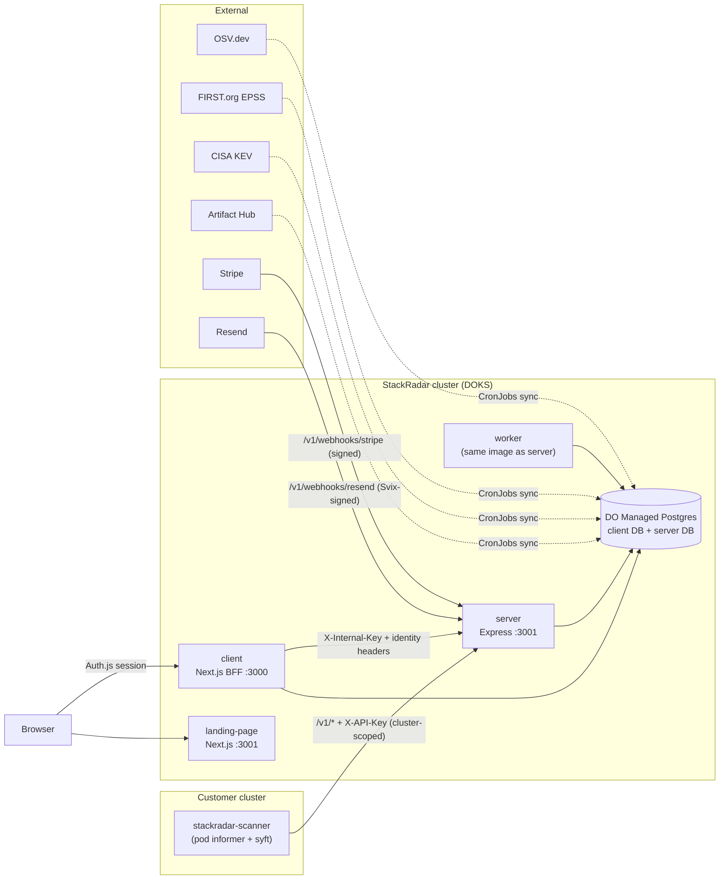
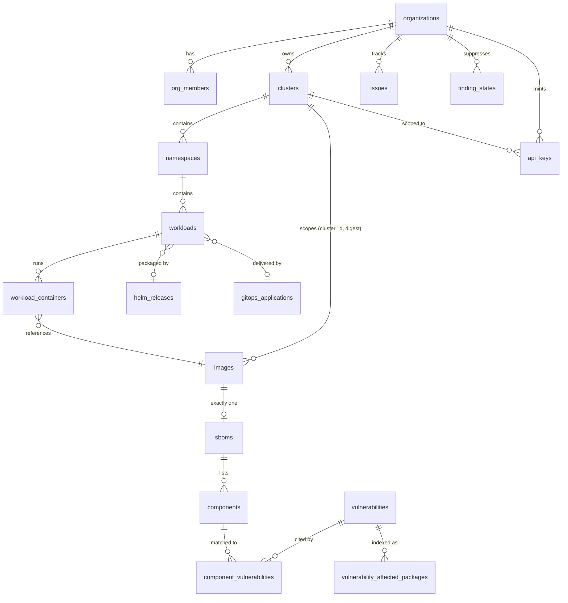
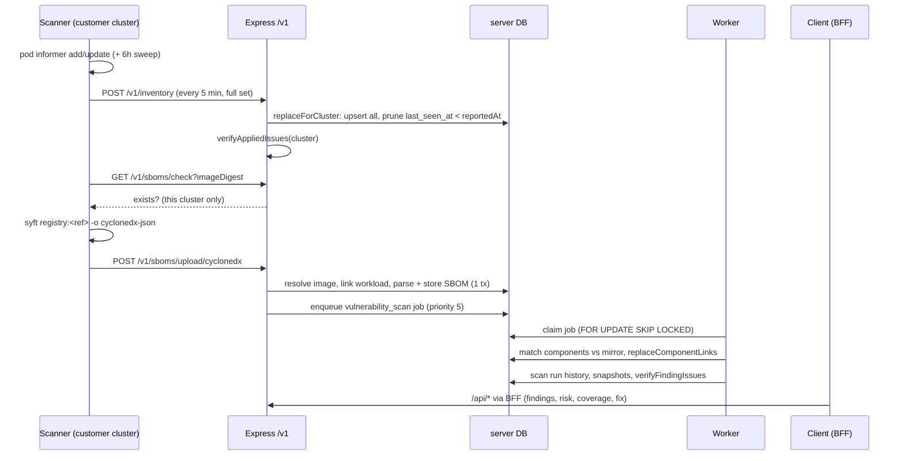

# StackRadar Architecture

**Status:** written 2026-08-22 from a full code audit of all four repositories, ahead of the production release. Every claim below was verified against source, not copied from existing docs; where the two disagree, this document follows the code and the disagreement is listed in [Appendix B](#appendix-b--documentation-drift). Section 13 is the pre-release read-over register.

StackRadar is an SBOM vulnerability tracking platform for Kubernetes. A read-only agent in the customer's cluster discovers what is running, generates a CycloneDX SBOM per image, and reports both to the platform. The platform mirrors the OSV.dev advisory database locally, matches components against it, and ranks the results with an exploitation-aware risk score (CVSS × EPSS × KEV). The product's positioning bet is prioritisation: not "here are your CVEs" but "fix this one first, and here is the exact command".

---

## 1. The system at a glance



Four git repositories:

| Repo | Contents | Deploys as |
|---|---|---|
| `stackradar` | Three **independent** pnpm apps: `server/` (Express 5 API), `client/` (Next.js 16 frontend + BFF), `landing-page/` (Next.js marketing site). No root package.json, no workspace — each app has its own lockfile (ADR 0001, amended). | Images in DO container registry |
| `stackradar-scanner` | The customer-side agent: TypeScript, Node 22, syft as an external binary. Helm chart in `helm/`. | OCI chart `oci://ghcr.io/lockdep/charts/stackradar-scanner` — the only install channel |
| `stackradar-gitops` | Production ArgoCD app-of-apps: `stack-radar-prod` namespace + landing page + infrastructure | `app.stackradar.io`, `api.stackradar.io`, `stackradar.io` |
| `stackradar-gitops-development` | Dev clone of the above, minus the landing page (moved to prod at the 2026-08-22 cutover) | `dev.app.stackradar.io`, `dev.api.stackradar.io` |

One PostgreSQL database on the DO Managed Postgres instance (open-source plan step 05, 10 Oct 2026, superseding ADR 0003's two databases): the Next.js app owns the **`auth` schema** (Auth.js identity tables — users, sessions, accounts, verification_tokens) and the server owns **`public`**; each keeps its own Drizzle journal (`auth.__drizzle_migrations`, `drizzle.__drizzle_migrations`). No foreign keys between the two — the server mirrors users by bare id. Locally, docker-compose runs PG 18 on port **5444** with the one database. The cloud's cutover from two databases to one is `docs/runbooks/auth-schema-cutover.md`.

---

## 2. Trust boundaries and authentication

There are exactly three ways into the Express server, plus two signed webhooks. Any auth change must account for all of them (client ADR 0001).

### 2.1 Browser → BFF (Auth.js session)

Authentication happens entirely at the Next.js layer. Auth.js v5 with GitHub/Google OAuth and **database sessions** (`client/src/auth.ts` — revocable server-side, 24 h sliding window, at the cost of a session-table lookup per request). `client/src/proxy.ts` (Next 16's rename of `middleware.ts`) is the page gate: everything outside `publicRoutes` redirects to `/login`, with an open-redirect guard on `callbackUrl`.

### 2.2 BFF → Express (`X-Internal-Key` + identity headers)

The browser never reaches Express directly (ADR 0002). One catch-all route, `client/src/app/api/[...path]/route.ts`, does the proxying:

1. `auth()` — no session → 401, never forwarded. `path[0] === "admin"` additionally requires `session.user.isAdmin`.
2. Headers are built **from scratch** by `createApiHeaders()` (`client/src/lib/api-utils.ts`) — incoming request headers are never spread in, so header injection through the BFF is structurally impossible. It sends: `X-Internal-Key`, `X-User-Id`, `X-User-Email`, `X-User-Name`, `X-Is-Admin`, and `X-Org-*` for the active org.
3. The active org comes from the `sr_org_id` cookie, but only after it is **validated against the user's real memberships** (fresh fetch of `/api/users/organizations` per request); an invalid cookie falls back to the first membership.
4. Request and response bodies stream; every upstream response header except `Content-Type` is dropped.

Only `api/auth`, `api/health/*` and `api/users/setup` have their own route files — Next.js routes static segments before the catch-all, so the exclusion is structural, not a denylist.

On the Express side (`server/src/middleware/auth.ts`), the headers are treated as a *claim*, not a fact: `requireOrg` re-verifies org membership with a DB lookup on every request, stamps the real `role`, and **overwrites** the header-supplied org object including `plan`. The one asymmetry: `X-Is-Admin` is **not** re-verified against the DB — the 19-route `/api/admin` surface hinges on the internal key alone (see finding H2).

### 2.3 Scanner → Express (`X-API-Key`, cluster-scoped)

The agent bypasses the BFF and calls six `/v1` endpoints directly — the ingress exposes exactly these as `pathType: Exact`, which is why `/metrics` and `/api/health` can stay unauthenticated (cluster-only by omission):

| Endpoint | Purpose |
|---|---|
| `POST /v1/heartbeat` | Liveness; records scanner version + Kubernetes version on the cluster row |
| `POST /v1/inventory` | Full-set replacement of the cluster's deployment inventory (contract: `docs/contracts/inventory-v3.md`) |
| `GET /v1/sboms/check` | "Has **this cluster** already scanned this digest?" |
| `POST /v1/sboms/upload/cyclonedx` | One SBOM per `(cluster, digest)`; `?replace=true` supersedes |
| `POST /v1/webhooks/stripe` | Signature-verified (`stripe.webhooks.constructEvent` on the raw body) |
| `POST /v1/webhooks/resend` | Svix HMAC verified by hand with `timingSafeEqual` (`server/src/lib/resend-webhook.ts`) |

Keys are 192-bit random values stored as SHA-256 hashes with an 8-char display prefix (`server/src/utils/api-key.ts`); a partial unique index guarantees at most one active key per hash. Every key is minted bound to a cluster, and every ingest handler re-asserts `apiKey.clusterId` (403 otherwise) — a leaked key can only write to its own cluster. `created_by` is deliberately never joined during validation, so an API-key context has no `userId` and can never pass a role check by construction. Token-bucket rate limits per key: 60/30·min on upload, 5/2·min on inventory.

### 2.4 Tenancy enforcement

`server/src/db/tenancy.ts` is the single rule: since ADR 0006, "may this org see this image" is the column check `images.org_id = $org` (plus a resolver each for SBOMs and components). Resolvers return `false` for both *missing* and *forbidden*, so every caller 404s uniformly and leaks nothing. Route-param guards (`requireOwnedCluster`, `loadContainer`) cover the cluster- and container-keyed surfaces. The audit found **no unscoped tenant read** — but note that the repository layer itself is unscoped (`vulnerability.repository.ts` contains zero `orgId`); tenancy lives one layer up, so a future controller that forgets the probe gets no safety net from below (finding M11).

### 2.5 What the server does *not* do itself

There is no helmet, no CORS middleware, no in-process rate limiter, no `trust proxy`, and no graceful shutdown on the API process. Security headers, HSTS, TLS, the 12 MB body ceiling and `limit-rps` all live in the **production ingress overlay only** (`stackradar-gitops/apps/stack-radar/overlays/production/patches/server-ingress.yaml`). The base overlay has neither rate limits nor HSTS. Express itself trusts its network position entirely (findings H3, M4).

---

## 3. The data model and its invariants

Read ADRs 0004, 0006 and the inventory-v3 contract before touching anything here — the model rests on a small set of load-bearing invariants.



### The invariants

1. **The image is the unit of identity, not the workload** (ADR 0004). SBOMs and findings key on an image digest; a workload doesn't *have* findings, it *references an image that does*. One image in five namespaces is one SBOM, one matching pass, one remediation action. The old `projects` tree, `discovered_workloads` and `sboms.isCurrent` are all gone.

2. **Images are cluster-scoped: identity is `(cluster_id, digest)`** (ADR 0006, reversing ADR 0004's sharing invariant). Nothing derived from an uploaded SBOM is ever shared across clusters — that is what makes SBOM poisoning and the "has anyone scanned digest X" oracle *impossible* rather than merely detected. `images.org_id` (denormalised, composite-FK'd to `clusters(id, org_id)` so the copies can't disagree) is the tenancy check.

3. **One SBOM per image**, enforced by `sboms_image_id_unique`. There is no "which SBOM" question; `?replace=true` is the supersede path, and two racing uploads are settled by the unique index, not application logic.

4. **Deployment context never touches `sboms`.** Tag, namespace, release, labels live on `workload_containers` and its parents; `sboms` carries only facts about the document itself (plus `scanner_version` provenance). A tag is what a deployment *asked for*, not a fact about the image.

5. **Packaging and delivery are separate relations.** ArgoCD commonly deploys *via* Helm, so a workload legitimately points at both a `helm_release` (what a CVE report cites) and a `gitops_application` (where the fix is made). A single `source` discriminator would force a choice between two true answers.

6. **"None" is never "unknown".** `namespaces.labels`, `workloads.kind` and `clusters.owner_metadata_collected` each carry a null meaning "we could not look" (usually an RBAC gap). Collapsing null into empty turns a permissions failure into a confident false statement about a customer's cluster. This propagates everywhere: two partial unique indexes on `workloads` exist solely so `kind IS NULL` rows have their own arbiter; the inventory upsert writes `excluded.*` verbatim (no coalesce) so an RBAC regression becomes visible instead of being masked by stale values.

7. **Advisory data and customer data share one table, guarded by FK direction** (server ADR 0003). OSV syncs straight into `vulnerabilities` (`source = "osv"`); `component_vulnerabilities` FKs to it with **RESTRICT** (a stray `DELETE FROM vulnerabilities` errors rather than cascading customer findings away) while the component side is CASCADE.

### Table groups (33 schema files, `server/src/db/schema/`)

- **Identity/tenancy:** `users` (mirrored from the client DB, case-insensitive email), `organizations` (plan, Stripe columns, soft-delete, `system` flag for the platform org), `org_members`, `org_invites`, `api_keys`, `terms_acceptances` + `org_terms_acceptances` (append-only evidence; org acceptance survives account erasure via `SET NULL`).
- **Inventory:** `clusters`, `namespaces`, `workloads`, `workload_containers` (identity includes `image_id` so a mid-rollout workload shows both digests), `helm_releases`, `gitops_applications`.
- **SBOM tree:** `images`, `sboms` (raw JSON kept, LZ4-compressed), `components` + satellites (hashes, external refs, properties, licenses, `component_dependencies`).
- **Advisories:** `vulnerabilities` (with the generated `risk_score` column and threat-intel columns written only by their own syncs), `vulnerability_affected_packages` (the denormalised match index: `match_key`, ecosystem family/release split, `generation` for atomic rebuilds), `component_vulnerabilities` (the match results, with full provenance).
- **Remediation:** `issues` (denormalised subject text so history survives image GC; CHECK constraints tie state to closed-reason and scope to subject), `finding_states` (suppressions keyed on cross-image finding identity), `activity_events` (append-only, the future notification source).
- **Jobs & sync state:** `jobs`, `vulnerability_scan_runs`, plus single-row state tables for OSV/EPSS/KEV/ArtifactHub sync.
- **Charts:** `chart_repositories` (note: plaintext `password` column — finding M9), `chart_repo_entries`, `artifact_hub_packages`, `chart_attributions`, `chart_renders`, `chart_image_observations`, metric snapshot tables.

### Migrations

24 Drizzle migrations (`0000`–`0023`). **Migrations are applied exclusively by ArgoCD PreSync jobs** — never run `db:migrate` locally; `pnpm db:generate` (authoring) is fine. The repo therefore records authorship, not application state; per the memory/docs trail, `0018`–`0023` were authored across August and land together on the next deploy. `0019` was hand-extended (backfills, FK action changes, LZ4, autovacuum tuning) — do not regenerate it.

---

## 4. Data flow end to end



### 4.1 Discovery (scanner)

`stackradar-scanner/src/watch.ts` runs a **pod informer** (watch, not polling) with `add`/`update` handlers; deletion is expressed implicitly by the next full-set inventory report. A 6-hour sweep re-lists everything and clears the seen-digest set. `podImages()` (`src/lib/scan.ts`) is the single rule both pipelines derive from: namespace include/exclude filters, pod-phase filter, init containers tagged, image digest extracted from `imageID`, `EXCLUDE_IMAGES` globs. Workload owners are resolved from `ownerReferences` without extra API calls (ReplicaSet → Deployment by stripping the pod-template-hash); Helm releases require positive evidence (annotations/labels); ArgoCD apps come from the tracking-id annotation plus an enrichment `list` of Application CRs. Everything that leaves the cluster passes through four snapshot-tested allowlists (12 pod labels, 2 pod annotations, 12 owner labels, 3 owner annotations) — widening one is a visible test diff.

### 4.2 Inventory (`POST /v1/inventory`, contract v3)

Each report is a **full set replacement** for one cluster, and the cluster comes from the API key, never the body. The server guards against destructive half-reports (`assertReplacementIsSafe`): `informerSynced === false` → 400, zero namespaces → 400 ("send no report instead"). *Caveat: the scanner currently hardcodes `informerSynced: true`, so only the second guard is real — finding H5.* The repository does one transaction: upsert releases → applications → namespaces → images → workloads → containers (batches of 500), stamping `last_seen_at = reportedAt`, then prune bottom-up where `last_seen_at < reportedAt`. Images are never deleted here — reclamation belongs to the nightly GC. Coverage (`scanned <= discovered`) is one LEFT JOIN by construction, not a filter call sites must remember.

### 4.3 SBOM ingestion (`POST /v1/sboms/upload/cyclonedx`)

Controller order matters: parse query → require cluster-scoped key → sniff SPDX (helpful 400) → Ajv-validate against the vendored CycloneDX 1.6 schema → resolve image on `(cluster_id, digest)` → **link the workload before storing** (so a duplicate SBOM still records the deployment) → parse and store in one transaction (components, hashes, refs, licenses, dependency edges; `isDirect` derived from the dependency graph) → enqueue a `vulnerability_scan` job. PURLs are normalised through `packageurl-js`, not stored verbatim.

### 4.4 Matching (`server/src/matching/`)

Runs in the worker, in batches of 50 components, one DB round-trip per batch:

1. **PURL only.** No PURL → no match; CPE and name-version matching are declared but not implemented (the `matched_by` column advertises values that cannot occur).
2. A second **indirect** pass follows the `upstream=` qualifier / source-RPM, using the *source* version, because distro advisories cite source packages.
3. Components with unanswerable versions (`""`, `"unknown"`, `"(devel)"`) are dropped — deliberately, this removed 31 % of one workload's rows, all noise.
4. `canonicalKey()` must produce the same key at ingest and match time (per-type rules: namespace joiners, case folding, PEP-503). **Changing any rule requires re-ingesting the mirror.**
5. Candidates come from the partial index on `match_key WHERE withdrawn = false`, scoped to the current `generation` (atomic mirror rebuilds).
6. Distro release scoping (`ecosystemMatchesDistro`) runs *before* version evaluation — this is what stops an Alpine 3.4 CVE attaching to an Alpine 3.23 package.
7. Version evaluation is three-valued (`affected` / `not affected` / `unorderable`); only a definite "not affected" kills a candidate. Twelve version comparators; any fuzzy comparison downgrades the verdict's confidence.
8. Results **replace** prior links (`replaceComponentLinks`) so a retracted verdict actually disappears.

### 4.5 What counts, and what it's worth

Two single-definition modules that every surface must go through:

- **`server/src/db/findings.ts` — what counts.** A finding is: on a *deployed* image (an `EXISTS` over `workload_containers`, never a join — a join would multiply findings by deployment count — plus a 1-hour grace for upload-before-inventory), with `match_confidence IN ('exact','fuzzy')` (`unconfirmed` excluded; this is the rule behind the historical 195-vs-14 count discrepancy), collapsed across aliases on `finding_identity` (one row per CVE, not one per source database).
- **`server/src/db/risk-model.ts` + `risk.ts` — what it's worth.** See §5.

### 4.6 Whose finding it is — two labels, two columns each (2026-09-17)

`docs/component-tier-plan-2026-09-13.md`. Neither label is in the score, and neither ever hides or suppresses anything; both decide what is *shown first* and what can be *recommended*.

**Application vs base image — a label on the component.**

| Column | Says | Written by |
|---|---|---|
| `components.tier` (+ `tier_version`) | what *kind* of thing the occurrence is: `os` / `runtime` / `application` / `main` / `unknown` | `lib/component-tier.ts`, pure, at ingest; re-computable from `component_properties` by `pnpm backfill:component-tier` |
| `components.from_base` (+ `layer_index`) | whether it *came from* the base image's layers; null until the boundary is known | `lib/base-image.ts` → `services/base-image.service.ts` |

Two columns because kind and provenance answer different questions, and only kind is derivable from every SBOM ever stored. They are columns on `components`, not property rows, because every findings query already joins `components` and a predicate in the unindexed name/value table would undo the db-perf fencing. Per *occurrence*, never per package: the same npm package is `application` under `/app/node_modules` and `runtime` inside node's bundled npm.

`db/finding-tier.ts` is the single definition of how they become a view ("Application · Base image · All"): **provenance when known, kind otherwise** (`lensBucket`); the lens is applied *after* `collapsedFindings`' collapse (a predicate inside it would break rule 5's scope contract); a finding on KEV or with EPSS ≥ `NOTABLE_EPSS` passes every lens, marked `shownDespiteTier`; every lensed response carries `tierCounts` for all buckets. A `?tier=` value selects its *bucket*, which is why switching from kind to provenance changed one SQL expression and no endpoint.

Where the base ends (`images.base_image_ref` / `base_layer_count` / `base_detected_by`), signals first-wins: the image's own OCI base annotations → a known public image as its prefix (`known_layer_prefixes`, hash of the whole chain, **public sources only — never written from an upload**, ADR 0006) → a prefix shared inside the org → buildpacks metadata → history (a stage-ending `CMD`/`ENTRYPOINT` agreeing with the largest jump in layer build time; named only by a `_VERSION` guess a registry *verified* layer for layer). Layers come from scanner ≥ 0.4.0 (`stackradar:layer:*` on `metadata.component`, syft `--scope deep-squashed` — under the default scope an apk/rpm package's only location is the package database, i.e. the last layer that ran the package manager) or, for public images scanned earlier, from the registry (`image_layers.source`). `components.layer_index` is the **minimum** over all `syft:location:N:layerID`, never location 0.

**Yours vs third-party — a label on the image.** `images.control` / `control_detected_by` / `control_detail`, derived from the *repository* by `lib/image-control.ts`: org rule (`image_control_rules`, always wins) → delivered by a public chart whose rendered image set names the repository → Docker Official Image annotation → private registry → layer match against a known public image → vendor namespace → `unknown`, which recommendations treat as yours. A label, never a score — the rule against per-repository scores holds.

Together they are the matrix that decides which recommendation exists: for an image the org builds, dependency bumps (`dependencyBumpCommand`) and a base rebuild (`services/base-upgrade.service.ts`: today's digest of the base's tag and the newest comparable newer tag, platform-scanned, diffed against the image's base-bucket findings — "removes N of M"); for a third-party image, one action per image — the chart or tag upgrade — or "waiting on upstream". The Radar Score is partitioned by control on its page (`byControl`), the same sum, never a second score.

---

## 5. The risk model (Radar Score)

Two layers, and the split is forced by the data model (ADRs 0005 + 0007):

**Layer 1 — per-finding, 0–100, a generated column.** `vulnerabilities.risk_score` is `GENERATED ALWAYS AS (…) STORED`:

```
risk = 100 × impact × exploitability
impact         = clamp(cvss, 0, 10) / 10, falling back to the severity band midpoint
exploitability = 1.0 if on CISA KEV
                 else ∛(EPSS probability)   (cube root: monotone, reshapes distance not order)
                 else 0.10                  (≈ corpus median when unscored)
```

Because every input is a column of the same row, the daily EPSS refresh *is* the recomputation, drift is unrepresentable (no caller can write the column — there's a test asserting the error), and changing the formula is a migration on purpose: the formula is a product decision. **Exposure (pod count, age, init flag) is deliberately in neither layer** — every input to the number is a public fact with a URL, and a "×1.15 for twelve pods" multiplier would be the first thing a security engineer attacks. Exposure renders as its own sortable columns.

**Layer 2 — the aggregate is an unbounded sum** (ADR 0007, which replaced ADR 0005's bounded fold). A rollup's score is `Σ risk` over its distinct findings — Dependency-Track's "inherited risk" shape, but with EPSS/KEV inside every term (a KEV critical adds ~98; a never-exploited critical adds ~7). It composes (org = Σ clusters), it moves when you fix things, and it deliberately gives up worst-domination: **a rollup's colour band is its worst finding's band, never a threshold on the total.** Any UI that colours an aggregate with `riskBand(total)` is a bug. `RISK_BANDS` (critical ≥ 60, high ≥ 35, medium ≥ 20, low ≥ 1; recalibrated for EPSS v5 on 2026-09-27, were 70/40/15) are defined over a single finding only.

Naming discipline: "Radar Score" is the unbounded aggregate; a finding's 0–100 value is its **contribution**; never describe it as "CVSS × EPSS × KEV" verbatim in UI copy.

---

## 6. Background processing

**The worker** (`server/src/worker.ts`) is a separate process on the same image, and background jobs live in the `jobs` table (server ADR 0002 — no broker; job state is transactional with application data). Claiming is `FOR UPDATE SKIP LOCKED` ordered by `(priority DESC, created_at)`, so multiple workers are safe — but the claimed batch executes **sequentially**, so effective concurrency is one job per worker process, and production runs exactly one worker (deliberately: its in-process crons have no leader election). Priorities in use: 5 = upload-triggered scan, 1 = fleet rescan after a mirror change, 0 = default.

Two things people will assume that are not true:

- **There is no automatic retry.** A failed job stays failed until a human clicks retry in the UI; `maxRetries` only bounds that manual path. The single exception is a deferral: `OsvMirrorNotReadyError` re-queues as pending.
- **Stale-job recovery runs only at worker startup**, not periodically. A job orphaned by a crash waits for the next worker restart to be failed with `STALE_TIMEOUT`.

**In-process crons** (croner, inside the single worker): hourly cleanup and metrics snapshots, nightly image GC (orphaned digests past the plan retention window, 500/night), chart repo sync (04:45), chart render enqueue (05:15).

**Kubernetes CronJobs** (gitops, all `concurrencyPolicy: Forbid`): hourly OSV incremental sync, 12-hourly OSV `--bootstrap-if-needed` (the hourly path refuses to bootstrap by design), daily EPSS (06:00), KEV (06:30), Artifact Hub (02:15 — must precede the 04:45 chart repo sync; the coupling is documented in the manifest).

**The OSV mirror** (`server/src/osv-sync/`, server ADR 0001): ~300k+ advisories mirrored locally because matching against a remote API is impractical. Bootstrap streams the 1.35 GB `all.zip` into `generation live+1` while readers keep serving `live`, with sanity thresholds before promotion; incremental polls `modified_id.csv` with an overlap window and keeps the watermark behind any failure. Advisory writes go through exactly one function (`bulkUpsertFromSync`). After any cycle that changed data, one `INSERT…SELECT` queues a priority-1 rescan for every image with an SBOM. A `pg_try_advisory_lock` makes concurrent runs a no-op. EPSS syncs via a staged temp table with a 150k-row floor checked *inside* the transaction (a truncated download can't blank scores); KEV is a full replacement **in both directions** — delisting clears `kev_listed_at`, because a stale KEV pins exploitability at 1.0 forever.

---

## 7. The product layer

**Organizations & roles.** `owner | admin | member`; owner can't be demoted, removed, or leave (delete the org instead); only owner promotes to admin. Org deletion is owner-only and soft: Stripe cancellation runs *first* and aborts on failure, then `deleted_at` is set, API keys deactivated, invites deleted. Slugs free up on soft-delete via a partial unique index.

**Invites.** Token (32 random bytes) is the capability; `GET /api/invites/:token` is deliberately unauthenticated. 7-day expiry, filtered at read time — the cleanup sweep (`deleteExpiredInvites`) exists but **nothing calls it** (finding M6). Acceptance re-checks the member limit under `SELECT FOR UPDATE` on the org row, all in one transaction with the terms evidence.

**Billing (Stripe).** Plans in `server/src/config/plans.ts`: free (1 cluster / 1 member / 30-day history), pro (5/10/365), team — **sold as "Business", key stays `team`** (15/25/730). Image caps were removed; the plans file itself notes the cluster count is now the only bound on a free org. Limits are hard-enforced (403 `PLAN_LIMIT_EXCEEDED`) at create time under row locks; history windows are *real retention* — read-clamped immediately and deleted by the hourly sweeps, which is why a downgrade genuinely shortens history. Webhook handlers deliberately ignore event payloads and re-fetch live subscription state, making them replay- and order-proof without an event ledger. `past_due` stays paid so dunning doesn't trigger history deletion. Checkout customers are created without an email on purpose (Stripe collects it — user-set billing email; portal email-edit is a known TODO).

**Terms.** `CURRENT_TERMS_VERSION = "2026-08-20"`, in verified lockstep with `landing-page/src/lib/legal.ts`. Two append-only evidence tables; org acceptance freezes the acceptor's role at acceptance time. Enforcement is client-side only (the AppShell gate) — the server records and reports but never blocks (deliberate, but worth knowing).

**Remediation (the Fix surface).** `remediation.service.ts` produces the per-image rollup with its fixable / awaiting-fix / EOL split (`lib/eol-releases.ts` owns EOL verdicts from a vendored date table, stamped `2026-08-16`; **unknown is never EOL**). `lib/remediation-commands.ts` is refusal-first: GitOps-managed workloads get "where the fix is made in git", never an imperative command a sync would revert; kubectl commands only for kinds where `set image` is real; no proven delivery method → no command. Issues (`image | release | finding` scopes) have a state machine where `verified` is written **only by the sweeps** — the inventory sweep for image/release issues (positive evidence only), the post-scan sweep for finding issues — never by a request; the user's exit is `closed` with a mandatory reason. Suppressions require owner + reason + expiry, key on cross-image finding identity, and are excluded *only* on the Fix surface — the risk score still counts suppressed findings on purpose. The client's Fix tab was removed on 2026-09-07 (to be reimplemented later); the server side and the `/api/remediation/*` endpoints remain, reachable through the BFF with no UI in front of them.

**Upgrade recommendations.** Two axes — a newer *scanned* tag of the same repository, and a newer version of the same chart — both org-scoped by a *required* argument (tags are tenant data even though the comparison logic isn't). `lib/image-tags.ts`'s job is **refusal, not ordering**: tags are comparable only with identical variants and equal precision; `latest`, SHAs and pre-releases are returned as refusals with reasons so the UI can say "three tags we declined to order" instead of guessing. `not-measured` is deliberately distinct from "up to date". Suggestion copy says "could address up to", never "will".

---

## 8. The client

Next.js 16 + React 19, Tailwind v4, no data-fetching library (deliberate — plain `fetch` into `useState` via a small hook layer: `useResource`, `usePagedResource` with 300 ms debounce and stale-but-visible tables, `useRevalidateOnFocus`).

- **Shell:** routes under `app/(app)/` share the sidebar layout; each renders a view from `src/views/`. Gates run in order: session → org setup → terms → onboarding, all failing open on fetch errors. `/login` and `/invite/[token]` live outside the shell (the invite page fetches Express directly server-side, since the BFF 401s sessionless requests).
- **Active org:** tracked in *both* localStorage (browser preference) and the `sr_org_id` cookie (what the BFF validates and forwards). `OrganizationProvider` also handles the landing page's `?intent=upgrade-pro|team` checkout handoff.
- **Runtime config over build-time env:** `SCANNER_CHART_VERSION` and `POSTHOG_KEY` are read server-side in `layout.tsx` and passed as props — nothing is `NEXT_PUBLIC_`-inlined, so one image serves every environment, configured by the gitops `client-config` ConfigMap. Prefer this pattern over PostHog feature flags.
- **Theming:** GitHub Primer primitives → three-layer `theme.css` (generated primitives → semantic tokens → Tailwind bridge), synced by script and **CI-enforced** (`primer-token-drift.yaml`) — never hand-edit `theme.css`. Dark mode is `data-theme` on `<html>`, applied pre-paint by an inline script.
- **Workloads list** groups flat `workload_containers` rows by namespace at read time — grouping is a lens, not a stored hierarchy, which is why images and releases can have their own pages without becoming sidebar sections.

## 9. The landing page

Separate app on purpose (landing ADR 0001): no auth, no DB, links out to `app.stackradar.io/login`. Docs are a pure TS registry (`src/lib/docs.ts`, 12 pages) rendered as hand-written TSX — no MDX. Two build-time guards: `shots:check` (product screenshots must exist and be current; retakes are *renames* because of a 31-day image cache) is in the build; `tokens:check` is not (finding L10). Pricing numbers, plan limits and the terms version are hand-mirrored from the server — all verified in lockstep today, but held together by comments, not checks (finding L8). Install commands and the chart version are injected at request time from `SCANNER_CHART_VERSION` (`force-dynamic` on install pages). PostHog uses memory-only persistence — no cookies, no consent banner, at the cost of person-level funnels.

## 10. The scanner

Single-replica Deployment, non-privileged to a fault: `runAsNonRoot`, read-only rootfs, all capabilities dropped, **no container-runtime socket** — syft pulls images over the network with `registry:` refs. RBAC is read-only and gated per feature: pods list/watch always; owner `get`s, ArgoCD Application `list`, and (opt-in, default **false**, template-fails without explicit names) `secrets get` for image pull credentials. NetworkPolicy on by default. Chart version == app version == image tag, stamped by CI from the git tag; the chart pins the image **by digest**; both artifacts are cosign-signed with SLSA provenance; the release workflow refuses to republish an existing version. `SCANNER_CHART_VERSION` in gitops must be bumped when a release goes out (this feeds both the client's install snippet and the landing docs).

Operational character worth knowing (details in §13): scan failures are not retried until the 6 h sweep; only socket-level errors are retried, never HTTP 5xx; a permanently-failed RBAC/ArgoCD probe stays failed until pod restart.

## 11. Deployment and operations

**App-of-apps:** one hand-applied root Application per cluster renders `argocd/` — 2 AppProjects, 6 infrastructure apps (ingress-nginx 4.15.1, cert-manager, kube-prometheus-stack, Loki, Alloy, ArgoCD ingress) and the workload app(s). ArgoCD itself is the one component *not* in git (installed by `kubectl apply` from upstream).

**Release flow:** pushing `client/**` or `server/**` builds an image and commits tag **+ digest** into the *dev* gitops repo (auto-sync on). Promotion to prod is a `workflow_dispatch` that verifies digests exist in the registry, smoke-builds kustomize, and opens a **PR** against the prod repo — and prod app auto-sync is currently **off**, so merge + manual sync is the deploy. Digest pinning exists because of a real incident (a reused mutable tag served four-month-old code). The landing page is the exception on every count: direct push to prod `main`, tag-only pinning, no promotion gate (finding M8).

**Migrations:** on the cloud, two ArgoCD PreSync hooks (server + client), `npx drizzle-kit migrate`, `backoffLimit: 0`, no ordering between them (finding M5). Self-hosted installs apply the same chains at boot instead (`MIGRATE_ON_START=true`; server `src/db/migrate.ts`, client `scripts/migrate.mjs`) under one shared Postgres advisory lock, so replicas of both apps serialise; `MIGRATE_EXIT_AFTER=true` is the one-shot initializer form.

**Secrets:** hand-created out of band (`kubectl create secret`), referenced by name; no sealed-secrets/SOPS/ESO, so no rotation or recovery path in git — the prod README step 5 is the only record of what must exist (finding H7).

**Conventions:** pods set CPU requests + memory limits, **never CPU limits** — verified clean across both repos. ConfigMaps are kustomize-generated (content-hashed) so config changes roll pods.

**Monitoring:** Prometheus + Grafana (IP-allowlisted ingress, admin via hand-created Secret), Loki single-binary (unauthenticated, protected only by NetworkPolicies — see H4), Alloy shipping only `stack-radar-*` namespaces. Seven OSV-mirror alert rules ship with the app; nothing alerts on the worker (finding H6).

---

## 12. Design decision index

| ADR | Decision | The reason to remember |
|---|---|---|
| [0001](adr/0001-pnpm-monorepo.md) | One repo, three independent pnpm apps | The workspace half was never built; don't assume hoisting or shared deps |
| [0002](adr/0002-bff-proxy-with-internal-service-key.md) | BFF proxies to Express with `INTERNAL_SERVICE_KEY` | Express trusts the key for identity headers; scanner is the deliberate bypass |
| [0003](adr/0003-separate-databases-per-context.md) | Separate auth and application databases | No cross-DB FKs; users referenced by bare ID |
| [0004](adr/0004-image-as-the-unit-of-identity.md) | Image digest is the unit of identity | Killed the `projects` tree; remediation names the thing the action is about |
| [0005](adr/0005-risk-is-two-layers.md) | Risk is two layers; advisory layer is a generated column | Exposure is deliberately not in the number; drift is unrepresentable |
| [0006](adr/0006-images-are-cluster-scoped.md) | Images are cluster-scoped `(cluster_id, digest)` | Makes SBOM poisoning impossible, not detectable; killed cluster-free ingest |
| [0007](adr/0007-aggregate-risk-is-an-unbounded-sum.md) | Aggregate risk is an unbounded sum | Band from worst finding, never from the total; the sum composes |
| server [0001](../server/docs/adr/0001-local-osv-mirror.md) | Mirror OSV locally | We own sync correctness: watermarks, generations, failure tracking |
| server [0002](../server/docs/adr/0002-custom-polling-job-queue.md) | Postgres-polling job queue | No broker; revisit before job volume outgrows polling |
| server [0003](../server/docs/adr/0003-separate-raw-and-application-vulnerability-models.md) | OSV syncs directly into `vulnerabilities` | The "raw mirror" split was never built; the RESTRICT FK is the guardrail |
| client [0001](../client/docs/adr/0001-database-sessions-and-scanner-upload-bypass.md) | Database sessions; scanner bypasses the BFF | Two trust paths into Express; both must be considered in any auth change |
| landing [0001](../landing-page/docs/adr/0001-marketing-site-as-separate-app.md) | Marketing site is a separate app | It can never read user state; shared branding is duplicated deliberately |

Contracts: [inventory-v3.md](contracts/inventory-v3.md) is the scanner↔server wire format — both repos encode it, so change the contract first. The proposals backlog ([proposals/README.md](proposals/README.md)) records what is done vs. deferred, and *why* two of the ranking phases were unbuildable as specified.

---

## 13. Pre-release read-over register

Everything below was verified against source during this audit (2026-08-22). Items already tracked in [security-review-2026-08-22.md](security-review-2026-08-22.md) are cross-referenced rather than restated in full. Ordered by how much they should influence the go/no-go.

### Blockers — resolve before public launch

- **B1 · Legal pages are drafts.** `/terms` and `/privacy` render with all eight identity placeholders (`[LEGAL ENTITY NAME]`, governing law, supervisory authority…) plus a visible "Draft — not yet in force" banner (`landing-page/src/lib/legal.ts`). Self-announcing, but not launchable.
- **B2 · The hardening set is uncommitted.** In *both* gitops repos, the pod `securityContext` blocks, PSA labels, ingress rate limits, reduced body size, ArgoCD allowlist — and both `network-policies.yaml` files — are **working-tree only** (NetworkPolicies untracked). The manifests read hardened; the clusters run the previous commit. The ingress-nginx 4.15.1 bump *is* committed. Same story for the scanner A1 fixes (uncommitted in the scanner repo) and the security review Phase 1 code changes (uncommitted across four repos). Committing and rolling these out, dev first, is the single highest-leverage pre-launch action.
- **B3 · Landing page advertises the Fix tab as shipped; it no longer exists in the client.** `HowItWorksSection` step 5 and FAQ 5 describe it in present tense; the tab was removed on 2026-09-07 pending a reimplementation. Move that copy behind the same "planned" discipline the pricing section already uses.
- **B4 · Manual ops leftovers from the security review** (its own checklist): rotate/move the Grafana admin secret on both clusters, dev Grafana DNS, GitHub session revoke, and the unverified DO backup/PITR story (review item I6) — there is no backup evidence in git.

### High — fix before or immediately after launch

- **H1 · Prod deploy path is unexercised.** `stack-radar-prod` has `automated.enabled: false` and the promote-to-prod workflow produces a PR that has never been merged — the production app namespace has not yet run the app. The first prod deploy will also apply migrations `0018`→`0023` in one PreSync. Do a full dry run (promote → merge → sync → migration hooks → smoke test) before announcing anything.
- **H2 · `X-Is-Admin` is trusted from the header.** `requireOrg` re-verifies org membership in the DB, but `requireAdmin` trusts the BFF header — the whole 19-route `/api/admin` surface hinges on `INTERNAL_SERVICE_KEY` alone (`server/src/middleware/auth.ts:393`). Re-verify `users.isAdmin` server-side (it's one lookup) to make the two claims symmetric.
- **H3 · Internal key comparison is not constant-time.** `internalKey === serverKey` (`auth.ts:141`); the Resend webhook already does `timingSafeEqual` correctly — mirror it.
- **H4 · Loki is unauthenticated and its only shield (NetworkPolicies) doesn't exist in the `monitoring` namespace at all** — request logs carry user/org context. Follows from B2, but worth its own line.
- **H5 · The scanner's `informerSynced` is hardcoded `true`** (`scan.ts:1255`; the override `watch.ts` promises never happens). The server-side guard against a half-synced report wiping a tenant's inventory is currently a constant; only the zero-namespace check is real. One-line fix in the scanner, then a chart release.
- **H6 · The worker is a single replica with no probes, no alerts, and no automatic job retry.** A wedged worker (stuck syft/helm on tenant input) is never restarted, never surfaces to Kubernetes, and every failed scan waits for a human. At minimum: add a liveness probe, run `recoverStaleJobs` periodically instead of only at startup, and alert on queue depth/age.
- **H7 · Secrets are hand-created with no rotation or recovery path**; the landing-page CI pushes straight to prod `main` with a write token, and the `stack-radar` AppProject can mint ClusterRoles — anyone who can commit to `apps/` can escalate. Sealed-secrets/ESO + branch protection are the structural fixes.
- **H8 · `STRIPE_TEAM_PRICE_ID` is not in `REQUIRED_ENV_VARS`** — a validly-booted server 500s on every Business checkout. One-line fix in `server/src/config/index.ts`.

### Medium — schedule deliberately

- **M1 · Scanner retry semantics.** A failed scan's digest stays "seen" for 6 hours (forever if the sweep is disabled); only socket-level errors are retried, never 5xx/429; `sboms/check` calls fan out unbounded outside the semaphore on cold start; SBOMs are double-buffered in memory against a 256 MB heap; temp files leak on syft timeout. None is individually fatal; together they define the agent's failure behaviour in customers' clusters.
- **M2 · API server lifecycle.** No graceful shutdown (in-flight requests die on rollout — with 2 replicas and rolling updates this is a real, recurring blip) and no `validateConfig()` in the worker (it boots on env the API would refuse).
- **M3 · Port confusion is latent.** Code and docs say `PORT=8080`; the Dockerfile and every manifest say 3001. Works today because the image sets it, but the first person to run the image with a hand-rolled env will chase this.
- **M4 · Express has no defenses of its own** (no helmet/CORS/rate limit/trust-proxy; base ingress overlay lacks HSTS and rate limits). Fine strictly behind the prod ingress; brittle against any second exposure path. Cheap to add helmet + a small default limiter.
- **M5 · The two migration PreSync hooks run unordered against the same database with `backoffLimit: 0`** — a transient DB blip fails the whole sync, and concurrent `drizzle-kit migrate` from two images is untested territory. Give them sync waves and a backoff.
- **M6 · Expired invites are never deleted** — `deleteExpiredInvites()` has no caller (its comment says the owning cron "does not exist yet"). Tokens accumulate as invisible-but-live rows.
- **M7 · Unauthenticated `GET /api/invites/:token`** is brute-forceable at ingress rate only (the in-process limiter only fires for API keys). 32 random bytes make guessing impractical; still worth a bucket.
- **M8 · Landing page deploys are the unhardened path**: mutable tag (`build-47`, no digest — the exact failure mode the app images were fixed for), direct push to prod main, single replica with default rolling strategy (brief 503s on every deploy of the public site).
- **M9 · `chart_repositories.password` is plaintext** in the server DB.
- **M10 · Resend webhook has no ordering guard** — a delayed retry can regress `delivered` back to `delivery_delayed`. Cosmetic today (status display only).
- **M11 · Tenancy has no second layer.** Repositories are deliberately unscoped; the controller-level probes are complete *today*, but nothing structural stops a new controller from reaching `vulnerability.repository` or `imageRepository.findById` unguarded. Consider making the tenancy probe a route-level middleware for image/sbom/component params, like `requireOwnedCluster` already is for clusters.
- **M12 · `vulnerability.controller.ts` has zero input validation** — malformed UUIDs surface as Postgres 500s, not 400s. The only controller without Zod.

### Lower / hygiene

- **L1** · Dead or unreachable code: `CLUSTER_NAME` (scanner), `full_sync` job type (no enqueue site), org-scoped API keys (representable, never minted), `deleteInvitesByEmail`, `GITOPS_TOOLS` includes `"flux"` nothing emits.
- **L2** · Landing copy time-bombs: CRA deadline banner (11 Sept 2026), "900K+" repeated as a literal in 9 places, Enterprise "SLA" not marked `planned` while SSO is.
- **L3** · Scanner inventory quirks (documented in its own proposal, still live): `runningPods` counts Succeeded/Failed pods; crash-looping containers flap in and out of inventory across snapshots.
- **L4** · Client `/admin` renders its shell to non-admins (every data call 403s; cosmetic). `/profile` is a placeholder. The invite page hardcodes both OAuth buttons instead of using `isProviderEnabled()` — a missing Google config shows a button that fails on click.
- **L5** · Client has exactly one test file (`severity.test.ts`); server has 127 with real drift-guard tests (risk-model parity, finding-identity, EXPLAIN assertions). The imbalance is a choice; know it.
- **L6** · Plan limits/prices exist in three hand-synced copies (server `plans.ts`, client constants, landing pricing + retention docs) — all agree today; a `plans:check` script would make it stay true.
- **L7** · `/api/remediation/*` remains reachable through the BFF with no UI in front of it since the Fix tab's removal (2026-09-07). Decide whether the endpoints stay up until the reimplementation or get unmounted with it.
- **L8** · Rotation of a cluster API key is revoke-then-insert without a transaction — a crash between the two strands the cluster keyless.
- **L9** · Dev cluster uses the production Let's Encrypt issuer (comment says staging); ACME contact is `contact@link-base.io`, not a StackRadar address.
- **L10** · `tokens:check` is not in the landing build (unlike `shots:check`), so a Primer bump can drift theme + OG-image brand literals silently.

### Verified sound (no action — recorded so the next audit starts here)

- Tenancy: every `/api` router mounts the full gate stack; every id-taking handler filters by org or probes `tenancy.ts`; no unscoped tenant read found; scanner keys can only write to their own cluster.
- The BFF builds outbound headers from scratch — header injection and org spoofing are structurally impossible; the `sr_org_id` cookie is validated against real memberships per request.
- Both webhooks verify signatures correctly (Stripe SDK; hand-rolled Svix with `timingSafeEqual`); Stripe handlers are replay/order-proof by re-fetching live state.
- `lib/safe-fetch.ts` is a thorough SSRF guard (per-hop re-resolution, private ranges v4+v6, cluster-DNS suffix blocklist, HTTPS-required-in-prod).
- Scanner data egress is allowlisted and snapshot-tested; no secrets leave the cluster; non-privileged throughout; supply chain (digest pins, cosign, SLSA, immutable releases) is genuinely strong.
- Landing pricing/limits/terms-version match server enforcement exactly; the "no CPU limits" convention holds everywhere; app images are digest-pinned end to end; zero TODO/FIXME markers in server source; no secrets in any git history (per the security review).

---

## Appendix A — where things are

| Concern | Single source of truth |
|---|---|
| What counts as a finding | `server/src/db/findings.ts` (`collapsedFindings`) |
| What a finding is worth | `server/src/db/risk-model.ts`; folds in `server/src/db/risk.ts` |
| Tenancy rule | `server/src/db/tenancy.ts` |
| Plan limits | `server/src/config/plans.ts` |
| Terms version | `server/src/config/terms.ts` ↔ `landing-page/src/lib/legal.ts` |
| Scanner↔server contract | `docs/contracts/inventory-v3.md` |
| Advisory writes | `vulnerabilityRepository.bulkUpsertFromSync` (only writer) |
| Tag comparability | `server/src/lib/image-tags.ts` (refusal-first) |
| EOL verdicts | `server/src/lib/eol-releases.ts` (unknown is never EOL) |
| Remediation commands | `server/src/lib/remediation-commands.ts` (refusal-first) |
| Docs registry (marketing) | `landing-page/src/lib/docs.ts` |
| Runtime flags | gitops `client-config` ConfigMap (`SCANNER_CHART_VERSION`) |

## Appendix B — documentation drift

Existing docs that now contradict the code, found while verifying. Fix or delete before onboarding anyone against them.

1. **`server/CONTEXT.md` describes the deleted `projects` model** — Projects/Groups, `isCurrent`, per-project dedup. It predates ADR 0004 entirely and never mentions images, workload_containers, releases, issues, or risk. The most misleading file in the repo; rewrite or delete.
2. **`server/src/db/SCHEMA.md` § api_keys** still claims SBOM upload doesn't require a cluster-scoped key and that SBOMs can exist with no cluster — reversed by ADR 0006, contradicted by the 403 in `sbom.controller.ts`.
3. **`client/CLAUDE.md`** describes a state-switching shell at `src/app/page.tsx` and lists `ClustersView`/`ProfileView` — none exist; routing is file-system based via `(app)/`. (`client/CONTEXT.md` is accurate.)
4. **Root `CLAUDE.md`**: env block says `PORT=8080` (image ships 3001); the "agent does two things" section still points at inventory-**v2**.
5. **`server/src/middleware/auth.ts:90`** docstring claims `sk_live_` key format; keys are bare base64url.
6. **`server/src/epss-sync/README.md`** and `docs/proposals/risk-ranking.md` reference an `osv_vulns` table that never existed (the code corrects this in a comment).
7. **`server/src/routes/prometheus.routes.ts`** says the ingress exposes four `/v1` paths; it exposes six.
8. **`stackradar-gitops/README.md`** still says `stackradar.io` points at the dev cluster (pre-cutover) and asks for an ArgoCD ingress rename that's already done.
9. **`server/src/services/suggestion.service.ts:24`** references the `remediation_actions` table, renamed to `issues`.
10. `.claude/skills/database-drizzle/` carries the same pre-ADR-0004 table fossils (noted by the schema review itself).
