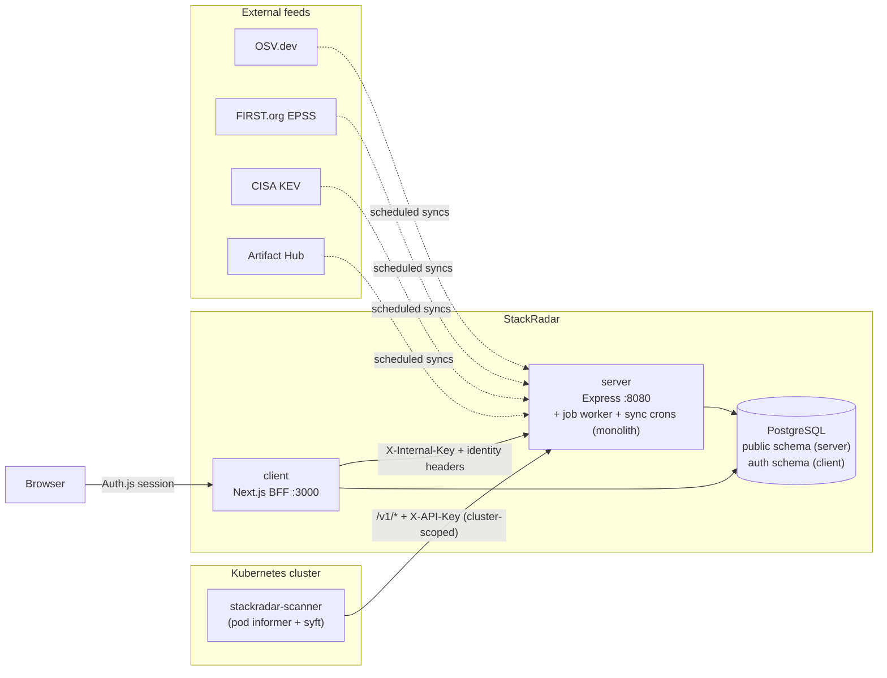
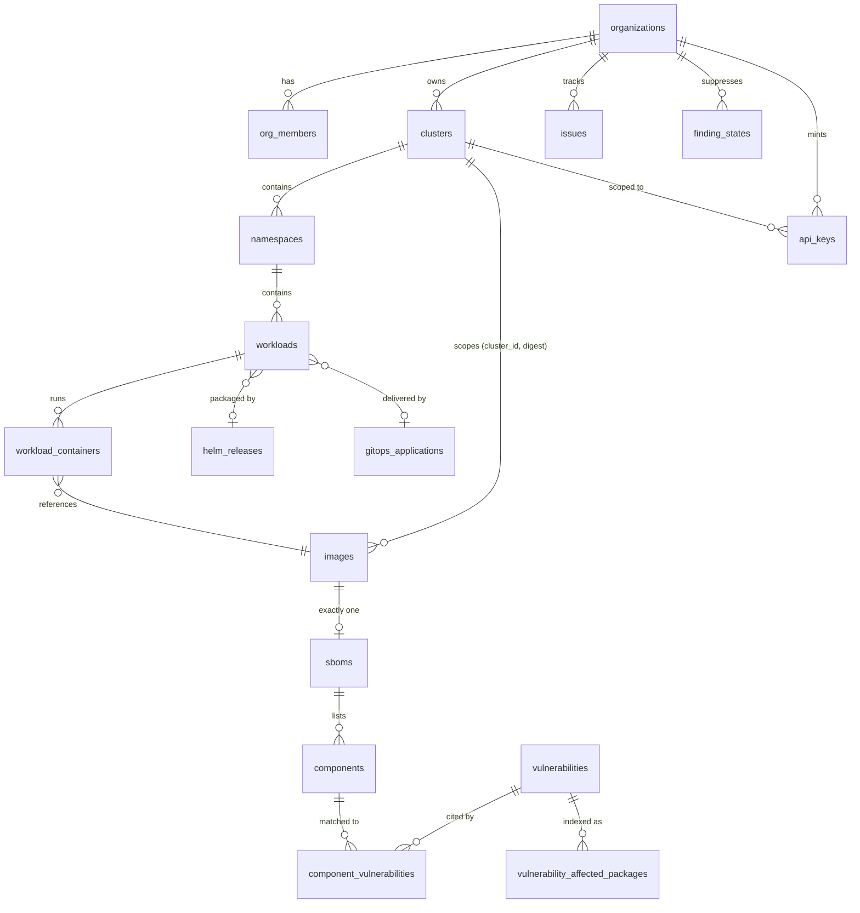
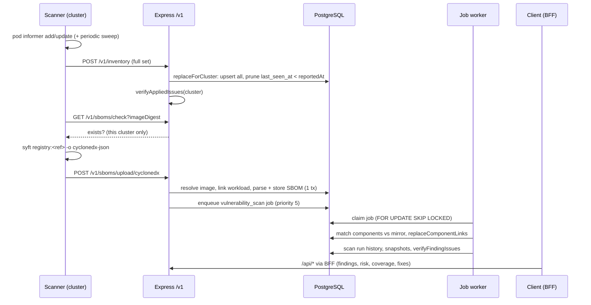

# StackRadar Architecture

*Last reviewed: 2026-10-11.* Every claim below is checked against the code in this repository; where another document disagrees, the code wins. File paths are relative to the repository root unless they start with `server/src/` or `client/src/`.

StackRadar is an SBOM vulnerability tracking platform for Kubernetes. A read-only agent in the cluster discovers what is running, generates a CycloneDX SBOM per image, and reports both to the server. The server mirrors the OSV.dev advisory database locally, matches components against it, and ranks the results with an exploitation-aware risk score built from CVSS, EPSS and the CISA KEV catalogue. The product's bet is prioritisation: not "here are your CVEs" but "fix this one first, and here is the exact command".

---

## 1. The system at a glance



This repository holds two **independent** pnpm projects (no root `package.json`, no workspace, one lockfile each — [ADR 0001](adr/0001-pnpm-monorepo.md)):

| App | What it is | Ships as |
|---|---|---|
| `server/` | Express 5 API, the job worker, the OSV/EPSS/KEV/Artifact Hub syncs and their CLIs. In the default `monolith` topology all of that is one process. | `ghcr.io/lockdep/stackradar-server` |
| `client/` | Next.js 16 UI plus the BFF that is the only thing a browser talks to. Owns authentication (Auth.js). | `ghcr.io/lockdep/stackradar-client` |

Two public sibling repositories complete the picture: [`lockdep/stackradar-scanner`](https://github.com/lockdep/stackradar-scanner), the in-cluster agent (TypeScript, Node 22, syft as an external binary; Helm chart in its `helm/`), and [`lockdep/stackradar-cli`](https://github.com/lockdep/stackradar-cli), a zero-signup `stackradar scan` command for a cluster you have `kubectl` access to. The scanner↔server wire format is [`contracts/inventory-v3.md`](contracts/inventory-v3.md); both repositories encode it, so change the contract first.

**One PostgreSQL database, two schemas.** The server owns `public` (images, SBOMs, advisories, inventory, orgs, jobs; journal `drizzle.__drizzle_migrations`). The client owns the **`auth` schema** (Auth.js users, sessions, accounts, verification tokens; `pgSchema("auth")` in `client/src/db/schema/`, journal `auth.__drizzle_migrations`). Both apps read the same `DATABASE_URL`. There are no foreign keys between the two — the server's `public.users` mirrors identities from `auth.users` by bare id. Locally, Compose runs PostgreSQL 18 on port **5444** with the one database (`scripts/init-db.sql`). This replaced the two-database design of [ADR 0003](adr/0003-separate-databases-per-context.md).

---

## 2. Trust boundaries and authentication

There are exactly two ways into the Express server in the community edition — the BFF and the scanner — and the cloud edition adds signed webhooks (§7). Any auth change must account for all of them ([client ADR 0001](../client/docs/adr/0001-database-sessions-and-scanner-upload-bypass.md)).

### 2.1 Browser → BFF (Auth.js session)

Authentication happens entirely at the Next.js layer. Auth.js v5 with **database sessions** (`client/src/auth.ts` — revocable server-side, at the cost of a session-table lookup per request). Sign-in methods are decided by environment (`client/src/lib/auth-providers.ts`): GitHub and Google OAuth, a generic OIDC issuer (`AUTH_OIDC_*`, with optional group-to-admin mapping), and local username/password (`AUTH_LOCAL_ENABLED`, on by default in the community edition, with a bootstrap admin that must change its password at first sign-in). `client/src/proxy.ts` (Next 16's rename of `middleware.ts`) is the page gate: everything outside `publicRoutes` redirects to `/login`, with an open-redirect guard on `callbackUrl`.

### 2.2 BFF → Express (`X-Internal-Key` + identity headers)

The browser never reaches Express directly ([ADR 0002](adr/0002-bff-proxy-with-internal-service-key.md)). One catch-all route, `client/src/app/api/[...path]/route.ts`, does the proxying:

1. `auth()` — no session → 401, never forwarded. `path[0] === "admin"` additionally requires `session.user.isAdmin`.
2. Headers are built **from scratch** by `createApiHeaders()` (`client/src/lib/api-utils.ts`) — incoming request headers are never spread in, so header injection through the BFF is structurally impossible. It sends `X-Internal-Key`, `X-User-Id`, `X-User-Email`, `X-User-Name`, `X-Is-Admin` (only for admins) and `X-Org-*` for the active org; free-text values are percent-encoded.
3. The active org comes from the `sr_org_id` cookie, but only after it is **validated against the user's real memberships**; an invalid cookie falls back to the first membership.
4. Request and response bodies stream; the caller's `Content-Type` is preserved and nothing else is.

Only `api/auth`, `api/health/*`, `api/users/setup`, `api/account/password`, `api/admin/users*` (local-account management), `api/admin/system` (the System tab: Express's report plus the client's own version, sign-in methods and auth-schema state) and `api/admin/chart-index` have their own route files — Next.js routes static segments before the catch-all, so the exclusion is structural, not a denylist.

On the Express side (`server/src/middleware/auth.ts`) the identity headers are a *claim*, not a fact: `requireOrg` re-verifies org membership with a DB lookup on every request, stamps the real `role`, and **overwrites** the header-supplied org object including `plan`. One claim is taken as-is by design: **`X-Is-Admin` is set by the BFF from the client's `auth.users.is_admin` and the server does not re-verify it** — `requireAdmin` reads `req.auth.isAdmin`. The 20-route `/api/admin` surface therefore rests on `INTERNAL_SERVICE_KEY` plus the BFF's own `admin/*` gate; the key must never reach a browser. API-key contexts carry no `userId`, so no role check can ever pass for a scanner key.

### 2.3 Scanner → Express (`X-API-Key`, cluster-scoped)

The agent bypasses the BFF and calls four `/v1` endpoints directly (`server/src/routes/public.routes.ts`), each behind `requireScope("sbom:write")`:

| Endpoint | Purpose |
|---|---|
| `POST /v1/heartbeat` | Liveness; records scanner version + Kubernetes version on the cluster row; the response carries fleet notices (`SCANNER_MIN_VERSION`, an operator message) |
| `POST /v1/inventory` | Full-set replacement of the cluster's deployment inventory ([contract](contracts/inventory-v3.md)) |
| `GET /v1/sboms/check` | "Has **this cluster** already scanned this digest?" |
| `POST /v1/sboms/upload/cyclonedx` | One SBOM per `(cluster, digest)`; `?replace=true` supersedes |

A deployment exposes exactly these paths to the scanner's network; `/metrics` (Prometheus scrape, no auth of its own) and `/internal/*` are meant to stay cluster-internal.

Keys are 24 random bytes as base64url (192 bits), stored as SHA-256 hashes with an 8-character display prefix (`server/src/utils/api-key.ts`); a partial unique index guarantees at most one active key per hash. With `API_KEY_ENCRYPTION_KEY` set, the plaintext is also kept encrypted (`lib/api-key-vault.ts`) so an admin can reveal it again. Every key is minted bound to a cluster, and every ingest handler re-asserts `apiKey.clusterId` (403 otherwise) — a leaked key can only write to its own cluster. `created_by` is audit metadata, never joined during validation, so an API-key context has no user by construction. Per-key token buckets (`middleware/rate-limit.ts`): upload capacity 60, refill 30/min; inventory capacity 5, refill 2/min.

### 2.4 Tenancy enforcement

`server/src/db/tenancy.ts` is the single rule: since ADR 0006, "may this org see this image" is the column check `images.org_id = $org` (plus a resolver each for SBOMs and components). Resolvers return `false` for both *missing* and *forbidden*, so every caller 404s uniformly and leaks nothing. Route-param guards (`requireOwnedCluster` in `cluster.controller.ts`, `loadContainer` in `workload.controller.ts`) cover the cluster- and container-keyed surfaces. **Tenancy is enforced in controllers; the repository layer is deliberately unscoped** — a new controller that reaches a repository without the probe gets no safety net from below, which is why every id-taking handler must go through `tenancy.ts` or a guard.

### 2.5 What the server does *not* do itself

Express mounts no helmet, no CORS middleware, no `trust proxy` and no global rate limiter (only the per-key buckets on `/v1`). It expects to sit behind the BFF and an ingress that own TLS, security headers and any edge rate limit. The JSON body ceiling is 10 MB (`express.json({ limit: "10mb" })` in `server/src/app.ts`). The internal-key comparison is a plain string equality.

---

## 3. The data model and its invariants

Read ADRs 0004, 0006 and the inventory-v3 contract before touching anything here — the model rests on a small set of load-bearing invariants.



### The invariants

1. **The image is the unit of identity, not the workload** ([ADR 0004](adr/0004-image-as-the-unit-of-identity.md)). SBOMs and findings key on an image digest; a workload doesn't *have* findings, it *references an image that does*. One image in five namespaces is one SBOM, one matching pass, one remediation action. The old `projects` tree, `discovered_workloads` and `sboms.isCurrent` are all gone.

2. **Images are cluster-scoped: identity is `(cluster_id, digest)`** ([ADR 0006](adr/0006-images-are-cluster-scoped.md), reversing ADR 0004's sharing invariant). Nothing derived from an uploaded SBOM is ever shared across clusters — that is what makes SBOM poisoning and the "has anyone scanned digest X" oracle *impossible* rather than merely detected. `images.org_id` (denormalised, composite-FK'd to `clusters(id, org_id)` so the copies can't disagree) is the tenancy check.

3. **One SBOM per image**, enforced by `sboms_image_id_unique`. There is no "which SBOM" question; `?replace=true` is the supersede path, and two racing uploads are settled by the unique index, not application logic.

4. **Deployment context never touches `sboms`.** Tag, namespace, release, labels live on `workload_containers` and its parents; `sboms` carries only facts about the document itself (plus `scanner_version` provenance). A tag is what a deployment *asked for*, not a fact about the image.

5. **Packaging and delivery are separate relations.** ArgoCD commonly deploys *via* Helm, so a workload legitimately points at both a `helm_release` (what a CVE report cites) and a `gitops_application` (where the fix is made). A single `source` discriminator would force a choice between two true answers.

6. **"None" is never "unknown".** `namespaces.labels`, `workloads.kind` and `clusters.owner_metadata_collected` each carry a null meaning "we could not look" (usually an RBAC gap). Collapsing null into empty turns a permissions failure into a confident false statement about a cluster. This propagates everywhere: two partial unique indexes on `workloads` exist solely so `kind IS NULL` rows have their own arbiter; the inventory upsert writes `excluded.*` verbatim (no coalesce) so an RBAC regression becomes visible instead of being masked by stale values.

7. **Advisory data and tenant data share one table, guarded by FK direction** ([server ADR 0003](../server/docs/adr/0003-separate-raw-and-application-vulnerability-models.md)). OSV syncs straight into `vulnerabilities` (`source = "osv"`); `component_vulnerabilities` FKs to it with **RESTRICT** (a stray `DELETE FROM vulnerabilities` errors rather than cascading tenant findings away) while the component side is CASCADE.

### Table groups (43 files in `server/src/db/schema/`, including the `index.ts` barrel)

- **Identity/tenancy:** `users` (mirrored from `auth.users`, case-insensitive email), `organizations` (plan, soft-delete, `system` and `demo` flags), `org_members`, `org_invites`, `api_keys`, `terms_acceptances` + `org_terms_acceptances` (append-only evidence; used by the cloud edition), `signup_attributions` and `feedback` (cloud edition).
- **Inventory:** `clusters`, `namespaces`, `workloads`, `workload_containers` (identity includes `image_id` so a mid-rollout workload shows both digests), `workload_container_history` (the past of `workload_containers`), `helm_releases`, `gitops_applications`.
- **SBOM tree:** `images`, `image_layers`, `sboms` (raw JSON kept, compressed), `components` + satellites (hashes, external refs, properties, licenses, `component_dependencies`).
- **Labels on components and images (§4.6):** `component_tier_rules`, `image_control_rules`, `known_layer_prefixes`, `base_image_checks`.
- **Advisories:** `vulnerabilities` (with the generated `risk_score` column and threat-intel columns written only by their own syncs), `vulnerability_affected_packages` (the denormalised match index: `match_key`, ecosystem family/release split, `generation` for atomic rebuilds), `component_vulnerabilities` (the match results, with full provenance), `vulnerability_scan_runs`.
- **Activity:** `activity_events` (append-only, the Feed's source). `issues` and `finding_states` remain in the schema with no code reading or writing them (the issue/suppression lifecycle was removed); they are retained for a two-release deprecation.
- **Jobs & sync state:** `jobs`, plus single-row state tables `osv_sync_state`, `epss_sync_state`, `kev_sync_state` and the Artifact Hub state.
- **Charts:** `chart_repositories` (note: the `password` column is plaintext), `chart_repo_entries`, `artifact_hub_packages`, `chart_attributions`, chart render/observation tables; **metrics:** cluster and org metric snapshots; **mail bookkeeping (cloud):** `alert_sends`, `digest_sends`.

### Migrations

The server has 28 Drizzle migrations (`server/drizzle/0000`–`0027`); the client has one (`client/drizzle/0000_auth_schema.sql`). Both chains are applied **at boot** when `MIGRATE_ON_START=true` — the server in `src/db/migrate.ts` (programmatic `migrate()` before it listens), the client in `scripts/migrate.mjs` (run by `docker-entrypoint.sh` before `next start`). Both take the same Postgres session advisory lock (`MIGRATION_LOCK_KEY`, kept in step by `scripts/check-cross-app-constants.mjs`), so any number of replicas of either app can start together: one migrates, the rest wait and find nothing to do. `MIGRATE_EXIT_AFTER=true` makes the same image a one-shot initializer that migrates and exits 0, for deployments that prefer a job. Hosted deployments may apply the same chains from their deploy pipeline instead and leave both flags unset; every path writes the same journals.

Authoring is `pnpm db:generate` in the app that owns the schema. Every schema change ships as a forward migration that works on a populated database; destructive changes need a two-release deprecation, because self-hosted installs upgrade on their own schedule. Never run `db:migrate`, `drizzle-kit push` or `db:reset` against a database you do not own.

---

## 4. Data flow end to end



### 4.1 Discovery (scanner)

The scanner's `src/watch.ts` runs a **pod informer** (watch, not polling) with `add`/`update` handlers; deletion is expressed implicitly by the next full-set inventory report. A periodic sweep (`SWEEP_INTERVAL_MS`, default 6 hours, `0` disables) re-lists everything and clears the seen-digest set. `podImages()` (`src/lib/scan.ts`) is the single rule both pipelines derive from: namespace include/exclude filters, pod-phase filter, init containers tagged, image digest extracted from `imageID`, `EXCLUDE_IMAGES` globs. Workload owners are resolved from `ownerReferences` without extra API calls (ReplicaSet → Deployment by stripping the pod-template-hash); Helm releases require positive evidence (annotations/labels); ArgoCD apps come from the tracking-id annotation plus an enrichment `list` of Application CRs. Everything that leaves the cluster passes through snapshot-tested allowlists of pod and owner labels/annotations — widening one is a visible test diff.

### 4.2 Inventory (`POST /v1/inventory`, contract v3)

Each report is a **full set replacement** for one cluster, and the cluster comes from the API key, never the body. The server guards against destructive half-reports (`assertReplacementIsSafe`): `informerSynced === false` → 400, zero namespaces → 400 ("send no report instead"). The scanner only publishes after its informer's initial list has completed, which is what lets it claim `informerSynced: true`. The repository does one transaction: upsert releases → applications → namespaces → images → workloads → containers (batches of 500), stamping `last_seen_at = reportedAt`, then prune bottom-up where `last_seen_at < reportedAt`. Images are never deleted here — reclamation belongs to the nightly GC. Coverage (`scanned <= discovered`) is one LEFT JOIN by construction, not a filter call sites must remember.

### 4.3 SBOM ingestion (`POST /v1/sboms/upload/cyclonedx`)

Controller order matters: parse query → require cluster-scoped key → sniff SPDX (helpful 400) → Ajv-validate against the vendored CycloneDX 1.6 schema (`server/src/validators/cyclonedx.validator.ts`, schemas in `server/src/schemas/cyclonedx-specifications/`) → resolve image on `(cluster_id, digest)` → **link the workload before storing** (so a duplicate SBOM still records the deployment) → parse and store in one transaction (components, hashes, refs, licenses, dependency edges; `isDirect` derived from the dependency graph) → enqueue a `vulnerability_scan` job. PURLs are normalised through `packageurl-js`, not stored verbatim.

### 4.4 Matching (`server/src/matching/`)

Runs in the worker, in batches of 50 components, one DB round-trip per batch:

1. **PURL only.** No PURL → no match; `matched_by` is always `"purl"` (CPE and name lookups are reserved, not implemented).
2. A second **indirect** pass follows the `upstream=` qualifier / source-RPM, using the *source* version, because distro advisories cite source packages.
3. Components with placeholder versions (`""`, `"unknown"`, `"(devel)"`) are dropped — deliberately; they only ever produced noise.
4. `canonicalKey()` (`matching/identity.ts`) must produce the same key at ingest and match time (per-type rules: namespace joiners, case folding, PEP-503). **Changing any rule requires re-ingesting the mirror.**
5. Candidates come from the partial index on `match_key WHERE withdrawn = false`, scoped to the current `generation` (atomic mirror rebuilds, `db/generation.ts`).
6. Distro release scoping (`ecosystemMatchesDistro`) runs *before* version evaluation — this is what stops an Alpine 3.4 CVE attaching to an Alpine 3.23 package.
7. Version evaluation is three-valued (`affected` / `not affected` / `unorderable`); only a definite "not affected" kills a candidate. Twelve version comparators live in `matching/version/`; any fuzzy comparison downgrades the verdict's confidence.
8. Results **replace** prior links (`replaceComponentLinks`) so a retracted verdict actually disappears.

### 4.5 What counts, and what it's worth

Two single-definition modules that every surface must go through:

- **`server/src/db/findings.ts` — what counts.** A finding is: on a *deployed* image (an `EXISTS` over `workload_containers`, never a join — a join would multiply findings by deployment count — plus a 1-hour grace for upload-before-inventory), with `match_confidence IN ('exact','fuzzy')` (`unconfirmed` excluded), collapsed across aliases on `finding_identity` (one row per CVE, not one per source database).
- **`server/src/db/risk-model.ts` + `risk.ts` — what it's worth.** See §5.

### 4.6 Whose finding it is — two labels, two columns each

Neither label is in the score, and neither ever hides or suppresses anything; both decide what is *shown first* and what can be *recommended*.

**Application vs base image — a label on the component.**

| Column | Says | Written by |
|---|---|---|
| `components.tier` (+ `tier_version`) | what *kind* of thing the occurrence is: `os` / `runtime` / `application` / `main` / `unknown` | `lib/component-tier.ts`, pure, at ingest; re-computable from `component_properties` by the `backfill:component-tier` script |
| `components.from_base` (+ `layer_index`) | whether it *came from* the base image's layers; null until the boundary is known | `lib/base-image.ts` → `services/base-image.service.ts` |

Two columns because kind and provenance answer different questions, and only kind is derivable from every SBOM ever stored. They are columns on `components`, not property rows, because every findings query already joins `components` and a predicate in the unindexed name/value table would undo the query fencing. Per *occurrence*, never per package: the same npm package is `application` under `/app/node_modules` and `runtime` inside node's bundled npm.

`db/finding-tier.ts` is the single definition of how they become a view ("Application · Base image · All"): **provenance when known, kind otherwise** (`lensBucket`); the lens is applied *after* `collapsedFindings`' collapse; a finding on KEV or with EPSS ≥ `NOTABLE_EPSS` passes every lens, marked `shownDespiteTier`; every lensed response carries `tierCounts` for all buckets. A `?tier=` value selects its *bucket*.

Where the base ends (`images.base_image_ref` / `base_layer_count` / `base_detected_by`), signals first-wins: the image's own OCI base annotations → a known public image as its prefix (`known_layer_prefixes`, hash of the whole chain, **public sources only — never written from an upload**, ADR 0006) → a prefix shared inside the org → buildpacks metadata → history (a stage-ending `CMD`/`ENTRYPOINT` agreeing with the largest jump in layer build time). Layers come from scanner ≥ 0.4.0 (`stackradar:layer:*` on `metadata.component`, syft `--scope deep-squashed`) or, for public images scanned earlier, from the registry (`image_layers.source`). `components.layer_index` is the **minimum** over all `syft:location:N:layerID`, never location 0.

**Yours vs third-party — a label on the image.** `images.control` / `control_detected_by` / `control_detail`, derived from the *repository* by `lib/image-control.ts`: org rule (`image_control_rules`, always wins) → delivered by a public chart whose rendered image set names the repository → Docker Official Image annotation → private registry → layer match against a known public image → vendor namespace → `unknown`, which recommendations treat as yours. A label, never a score — there is no per-repository score anywhere.

Together they are the matrix that decides which recommendation exists: for an image the org builds, dependency bumps (`dependencyBumpCommand`) and a base rebuild (`services/base-upgrade.service.ts`: today's digest of the base's tag and the newest comparable newer tag, diffed against the image's base-bucket findings — "removes N of M"); for a third-party image, one action per image — the chart or tag upgrade — or "waiting on upstream". The Radar Score is partitioned by control on its page (`byControl`), the same sum, never a second score.

---

## 5. The risk model (Radar Score)

Two layers, and the split is forced by the data model ([ADR 0005](adr/0005-risk-is-two-layers.md) + [ADR 0007](adr/0007-aggregate-risk-is-an-unbounded-sum.md)):

**Layer 1 — per-finding, 0–100, a generated column.** `vulnerabilities.risk_score` is `GENERATED ALWAYS AS (…) STORED`:

```
risk = 100 × impact × exploitability
impact         = clamp(cvss, 0, 10) / 10, falling back to the severity band midpoint
exploitability = 1.0 if on CISA KEV
                 else ∛(EPSS probability)   (cube root: monotone, reshapes distance not order)
                 else 0.10                  (≈ corpus median when unscored)
```

Because every input is a column of the same row, the daily EPSS refresh *is* the recomputation, drift is unrepresentable (no caller can write the column — there is a test asserting the error), and changing the formula is a migration on purpose: the formula is a product decision. **Exposure (pod count, age, init flag) is deliberately in neither layer** — every input to the number is a public fact with a URL, and a "×1.15 for twelve pods" multiplier would be the first thing a security engineer attacks. Exposure renders as its own sortable columns.

**Layer 2 — the aggregate is an unbounded sum** (ADR 0007, which replaced ADR 0005's bounded fold). A rollup's score is `Σ risk` over its distinct findings — Dependency-Track's "inherited risk" shape, but with EPSS/KEV inside every term (a KEV critical adds ~98; a never-exploited critical adds ~7). It composes (org = Σ clusters), it moves when you fix things, and it deliberately gives up worst-domination: **a rollup's colour band is its worst finding's band, never a threshold on the total.** Any UI that colours an aggregate with `riskBand(total)` is a bug. `RISK_BANDS` (critical ≥ 60, high ≥ 35, medium ≥ 20, low ≥ 1; `server/src/db/risk-model.ts`) are defined over a single finding only.

Naming discipline: "Radar Score" is the unbounded aggregate; a finding's 0–100 value is its **contribution**; never describe it as "CVSS × EPSS × KEV" verbatim in UI copy.

---

## 6. Background processing

**Topology** (`server/src/topology.ts`): `TOPOLOGY=monolith|split`; unset follows the edition (community → `monolith`, cloud → `split`). In the **monolith** — the community default and what Compose and the Helm chart run — the API process starts the job worker in-process after it listens and runs the feed syncs on in-process crons. In the **split** topology the worker is its own process on the same image (`dist/src/worker.js`) and the feed syncs are expected to be run externally — Kubernetes CronJobs invoking the same CLIs (`osv-sync --once`, `osv-sync --bootstrap-if-needed`, `epss-sync --once`, `kev-sync --once`, `artifacthub-sync --once`) — and the server process starts none of them.

**The job queue** lives in the `jobs` table ([server ADR 0002](../server/docs/adr/0002-custom-polling-job-queue.md) — no broker; job state is transactional with application data). Claiming is `FOR UPDATE SKIP LOCKED` ordered by `(priority DESC, created_at)`, **one job per claim**, executed sequentially — so a crash strands at most the job that was actually running, and multiple workers are safe. Priorities in use: 5 = upload-triggered scan, 1 = fleet rescan after a mirror change, 0 = default.

Two things people will assume that are not true:

- **Nothing retries a failed job on its own.** A failed job stays failed and visible in the admin Jobs tab; the next trigger that enqueues work (a re-upload with `?replace=true`, a mirror change) creates a new job. A platform admin can put one back as `pending` with its budget restored (`POST /api/admin/jobs/:id/retry`, or `…/jobs/retry-stuck` for every job that is out of retries) — that is a person deciding, not a policy. The single automatic exception is a deferral: `OsvMirrorNotReadyError` re-queues the job as pending.
- **Stale-job recovery is a sweep, not a watchdog.** A job `processing` for longer than `JOB_STALE_TIMEOUT_MS` (30 min) is failed with `STALE_TIMEOUT` by `recoverStaleJobs`, which runs at worker start-up and then every `JOB_STALE_CHECK_INTERVAL_MS` (60 s) between polls.

**Worker crons** (croner, inside the worker; schedules are env-overridable, see the header of `server/src/jobs/job-worker.ts`): hourly cleanup and metrics snapshots, nightly image GC at 03:30 (orphaned digests past the retention window — `IMAGE_GC_RETENTION_DAYS`, floored by the plan's history window), chart repo sync at 04:45, chart render selection at 05:15, image-layer registry backfill at 05:50, alert evaluation every 5 minutes.

**Feed syncs** (`server/src/sync-scheduler.ts` in the monolith; the same schedules as external CronJobs in the split topology, all UTC): OSV incremental hourly (`0 * * * *`), OSV bootstrap check every 12 h (`0 */12 * * *` — the hourly path refuses to bootstrap by design), EPSS daily at 06:15, KEV daily at 07:15, Artifact Hub daily at 02:15 (`ARTIFACT_HUB_SYNC_ENABLED=false` turns it off). **The Artifact Hub sync must precede the 04:45 chart repo sync** — chart attribution reads what it mirrored; keep that ordering if you change either schedule. The monolith also runs a **start-up pass**: the bootstrap check runs as soon as the server listens (so a fresh install has a mirror in minutes), and EPSS and KEV follow it, forced when a bootstrap just ran. Replicas are safe: the OSV sync holds a session advisory lock per run, EPSS and KEV take a transaction advisory lock on their apply (`lib/sync-lock.ts`), and the Artifact Hub sync's freshness guard makes a second run a no-op.

**The OSV mirror** (`server/src/osv-sync/`, [server ADR 0001](../server/docs/adr/0001-local-osv-mirror.md)): advisories are mirrored locally because matching against a remote API is impractical. `OSV_ECOSYSTEMS` scopes the mirror to a comma-separated list of OSV directory names (unset = the community default list; `*` = everything, ~2.5 GB of downloads); `osv_sync_state.ecosystems` records what the live generation carries and `--bootstrap-if-needed` rebuilds when the list was widened. Bootstrap streams `all.zip` (or one per ecosystem) into `generation live+1` while readers keep serving `live`, with sanity thresholds before promotion; incremental polls `modified_id.csv` with an overlap window and keeps the watermark behind any failure. Advisory writes go through exactly one function (`vulnerabilityRepository.bulkUpsertFromSync`). After any cycle that changed data, one `INSERT…SELECT` queues a priority-1 rescan for every image with an SBOM. EPSS syncs via a staged temp table with a 150k-row floor checked *inside* the transaction (`EPSS_MIN_ROWS_TO_APPLY` — a truncated download can't blank scores); KEV is a full replacement **in both directions** — delisting clears `kev_listed_at`, because a stale KEV pins exploitability at 1.0 forever.

---

## 7. The product layer

**Editions.** `server/src/edition.ts` and its mirror `client/src/lib/edition.ts`: **community** (the default; one organisation, one cluster, local login on, no billing) and **cloud** (`STACKRADAR_EDITION=cloud`; multi-org, plans, Stripe, Resend, terms, the live demo). Everything under `server/src/cloud/` is mounted only when `edition.isCloud` (`mountCloud` in `app.ts`); in the community edition those paths are 404s, not 403s. The per-route rules are in [`authorization-matrix.md`](authorization-matrix.md).

**Organizations & roles.** `owner | admin | member`; owner can't be demoted, removed, or leave (delete the org instead); only owner promotes to admin. Org deletion is owner-only and soft: in the cloud, Stripe cancellation runs *first* and aborts on failure; then `deleted_at` is set, API keys deactivated, invites deleted. Slugs free up on soft-delete via a partial unique index. In the community edition `requireMultiOrg` / `requireMultiCluster` (`middleware/edition.ts`) answer `403 single_organization` / `403 single_cluster`, and `services/default-org.service.ts` seeds the one org and the bootstrap cluster (`BOOTSTRAP_CLUSTER_ID` / `BOOTSTRAP_CLUSTER_API_KEY`) at start-up.

**Invites.** Token (32 random bytes, hex) is the capability; `GET /api/invites/:token` is deliberately unauthenticated. 7-day expiry, filtered at read time — `deleteExpiredInvites()` exists in `invite.repository.ts` but nothing calls it, so expired rows accumulate harmlessly. Acceptance re-checks the member limit under `SELECT FOR UPDATE` on the org row. The community edition returns a link only (email status `not_configured`); the cloud emails it.

**Billing — cloud edition only.** Plans in `server/src/config/plans.ts`: `free` is **no plan** (0 clusters / 1 member / 30-day history — the cloud has no Free plan; the community edition is the free tier), `pro` (5 / 10 / 365), `team` — sold as "Business", the key stays `team` because it is a stored value (15 / 25 / 730), and `community` (unlimited / unlimited / 365, the value every org gets when `!edition.billing`). Every plan starts with a 14-day card-required trial: the Checkout session carries `trial_period_days` (`cloud/billing/plans.ts` `TRIAL_DAYS`) and the trial *is* the Stripe subscription in `trialing` status — no trial state of our own; one trial per person (`users.trial_consumed_at`, stamped by the webhook). An org without a plan is read-only (`lib/plan-gate.ts`, `403 plan_required`): new orgs see the plan chooser, lapsed orgs a read-only dashboard, and their scanner keeps its heartbeat but loses ingest. Limits are hard-enforced (403 `PLAN_LIMIT_EXCEEDED`) at create time under row locks; history windows are *real retention* — read-clamped immediately and deleted by the hourly sweeps, which is why a downgrade genuinely shortens history. Stripe webhook handlers deliberately ignore event payloads and re-fetch live subscription state, making them replay- and order-proof without an event ledger; the same pass reads the trial's moments (`trial_started`, `trial_converted`, `trial_cancelled`, `plan_ended`) off the row it replaces and reports them to PostHog and the founder alert (`cloud/billing/plan-transitions.ts`). `past_due` stays paid so dunning doesn't trigger history deletion.

**Terms — cloud edition only.** `CURRENT_TERMS_VERSION` lives in `server/src/cloud/terms/version.ts`; the routes are mounted at `/api/users/terms*` by `cloud/index.ts`. Two append-only evidence tables; org acceptance freezes the acceptor's role at acceptance time. Enforcement is client-side (the cloud's `useTermsGate` in the AppShell) — the server records and reports but never blocks.

**Remediation.** `services/remediation-rollup.service.ts` produces the per-image rollup with its fixable / awaiting-fix / EOL split (`lib/eol-releases.ts` owns EOL verdicts from a vendored date table, `EOL_DATA_AS_OF = "2026-08-16"`; **unknown is never EOL**); `services/remediation.service.ts` turns it into the fixes list behind `GET /api/remediation/fixes`, the only remediation endpoint. `lib/remediation-commands.ts` is refusal-first: GitOps-managed workloads get "where the fix is made in git", never an imperative command a sync would revert; kubectl commands only for kinds where `set image` is real; no proven delivery method → no command. On the client the fixes list feeds the dashboard's "Fix these first" block, and the image and release pages carry their own remediation panels (`/api/images/:id/upgrade`, `/base-upgrade`, `/api/releases/:id/upgrade`). An earlier issue/suppression lifecycle was removed with no UI left to drive it; its two tables stay until a deprecation migration drops them.

**Upgrade recommendations.** Two axes — a newer *scanned* tag of the same repository, and a newer version of the same chart (`services/upgrade-recommendation.service.ts`) — both org-scoped by a *required* argument (tags are tenant data even though the comparison logic isn't). `lib/image-tags.ts`'s job is **refusal, not ordering**: tags are comparable only with identical variants and equal precision; `latest`, SHAs and pre-releases are returned as refusals with reasons so the UI can say "three tags we declined to order" instead of guessing. `not-measured` is deliberately distinct from "up to date". Suggestion copy says "could address up to", never "will".

**Activity feed.** `activity_events` carries **changes, never inventory** — one event per change, never one per finding. Two write sites: the inventory report diffs the cluster's containers per slot (`lib/container-slots.ts`, pure; `repositories/container-history.repository.ts` inside the inventory transaction) and records intervals in `workload_container_history` plus `container.*` events, a move carrying the finding delta between its two digests (`db/finding-delta.ts`); and the scan job emits one `scan.findings-changed` per image per scan (`cause: "mirror"` or `"upload"`). The Feed page (`/feed`, `GET /api/feed`) is its reader; day grouping and the folding of repeats happen in the view.

---

## 8. The client

Next.js 16 + React 19, Tailwind v4, no data-fetching library (deliberate — plain `fetch` into `useState` via a small hook layer in `client/src/hooks/`: `useResource`, `usePagedResource` with debounce and stale-but-visible tables, `useRevalidateOnFocus`, `usePollWhile`).

- **Shell:** routes under `app/(app)/` share the sidebar layout (`AppShell.tsx`): the dashboard at `/`, `/vulnerabilities`, `/packages`, `/containers`, `/images` (+ `/images/[id]`), `/clusters` (+ `/clusters/[id]` with tab sub-routes), `/releases/[id]`, `/radar-score`, `/feed`, `/admin`, `/org-settings`, `/profile`. Each renders a view from `src/views/`. Gates run in order: session → organisation setup → (cloud) terms → (cloud) the plan chooser until a new org has started a plan → onboarding until the org has its first cluster, all failing open on fetch errors; a lapsed org skips onboarding and renders read-only behind a banner (`cloud/billing/plan-state.ts`). `/login`, `/invite/[token]`, `/account/password` and `/demo` live outside the shell (the invite page fetches Express directly server-side, since the BFF 401s sessionless requests).
- **Active org:** tracked in *both* localStorage (browser preference) and the `sr_org_id` cookie (what the BFF validates and forwards), by `components/providers/OrganizationProvider.tsx`. The cloud edition's checkout handoff is `src/cloud/billing/UpgradeIntent.tsx`.
- **Runtime config over build-time env:** `SCANNER_CHART_VERSION` and `POSTHOG_KEY` are read server-side in `app/layout.tsx` and passed as props — nothing is `NEXT_PUBLIC_`-inlined, so one image serves every environment, configured by the deployment (env). The edition object is fetched from the server's `GET /api/edition` and mirrored in `lib/edition.ts`.
- **Cloud surfaces** are in `src/cloud/` and drawn behind an `edition` check — the `cloud-boundary` CI workflow keeps the rest of the client from importing them.
- **The admin page** (`/admin`, `views/admin/`) is one component tree for both editions. Each tab entry declares the capability it needs (`requires: 'multiOrg' | 'support' | 'isCloud' | 'localLogin'`) and the group it sits in (Health, Data, Advisories, People, Index — `TabBar` draws the group labels on wide screens), and the page filters on the capability alone; inside a tab, the tenant surface — org columns, plan panels, the Explorer's org picker — reads `edition.multiOrg`. The community edition sees the install's administration page; the cloud sees the same tabs plus the tenant ones. The Overview's top row is the pipeline, one tile per stage from scanner to KEV, each with its own tone; the scanner stage reuses the cluster page's `getScannerHealth` and `isScannerOutdated` so the two never disagree, and the mirror stage reads the same `buildMirrorStatus` as the fresh-install banner. Where a reading implies an action, the action is a button on it (`views/admin/ActionButton.tsx` over `POST /api/admin/*`, `services/admin-actions.service.ts`): retry a job, run a feed sync now, bootstrap the mirror if needed, collect orphaned images, rescan the fleet. Each runs the existing code path behind the lock it already takes — the feed triggers call the monolith scheduler's own runners, and in the split topology answer 409 naming the CronJob to run instead — refuses while the same action is in progress, and is logged with the acting admin; none writes `activity_events`.
- **Theming:** GitHub Primer primitives → three-layer `app/theme.css` (generated primitives → semantic tokens → Tailwind bridge), synced by script and **CI-enforced** (`primer-token-drift.yaml`) — never hand-edit `theme.css`. Dark mode is `data-theme` on `<html>`, applied pre-paint by an inline script.
- **Workloads list** groups flat `workload_containers` rows by namespace at read time — grouping is a lens, not a stored hierarchy, which is why images and releases can have their own pages without becoming sidebar sections.
- **Tests:** 30 client test files (Vitest, no database) against 202 server test files (Testcontainers, real PostgreSQL). The imbalance is a choice: the invariants live on the server.

---

## 9. The scanner

Lives in [`lockdep/stackradar-scanner`](https://github.com/lockdep/stackradar-scanner). Single-replica Deployment, non-privileged: `runAsNonRoot`, read-only root filesystem, **no container-runtime socket** — syft pulls images over the network with `registry:` refs. RBAC is read-only and gated per feature: pods list/watch always; owner `get`s and ArgoCD Application `list` for attribution; `secrets get` for image pull credentials is opt-in (default **off**, and only on the names you list via `resourceNames`). NetworkPolicy is on by default. Chart version == app version == image tag, stamped by CI from the git tag; the chart pins the image **by digest** (`image.digest` wins over `image.tag`); both artifacts are cosign-signed with provenance by the release workflow. The client's install snippet shows the chart version from the deployment's `SCANNER_CHART_VERSION`; bump it when a scanner release goes out. The server can tell the fleet about a floor (`SCANNER_MIN_VERSION`) and a notice through the heartbeat response.

Operational character worth knowing: a failed scan's digest stays "seen" until the next sweep (6 h by default); socket-level errors are retried and `429`/`503` honour `Retry-After`; other HTTP errors wait for the sweep.

---

## 10. Deployment and operations

The community edition is `server` + `client` + PostgreSQL, plus the scanner in the cluster being watched. Two supported installs, both documented under [`self-hosting/`](self-hosting/README.md):

- **Docker Compose** (`deploy/compose/docker-compose.yml`, [guide](self-hosting/docker-compose.md)): `postgres:18-alpine`, `ghcr.io/lockdep/stackradar-server` with `TOPOLOGY=monolith` and `MIGRATE_ON_START=true`, `ghcr.io/lockdep/stackradar-client` with `MIGRATE_ON_START=true`. The scanner is installed separately into the cluster you want watched, pointed at the server.
- **Helm** ([guide](self-hosting/helm.md); chart `charts/stackradar` in `lockdep/helm-charts`, published as `oci://ghcr.io/lockdep/helm-charts/stackradar`): the server (monolith), the client, a bundled single-node PostgreSQL 18, and the scanner as a subchart already pointed at the in-cluster server. Bringing your own PostgreSQL and OIDC are covered in [`own-postgres.md`](self-hosting/own-postgres.md) and [`oidc.md`](self-hosting/oidc.md).

**Topology and migrations.** Both installs run the monolith (§6) and apply migrations at boot under the shared advisory lock (§3); `MIGRATE_EXIT_AFTER=true` turns either image into a one-shot migration job for deployments that want the schema step separate from the rollout. Hosted deployments run the split topology and apply migrations from their own pipeline; the application code is the same.

**Resources.** The chart sets memory limits (the server needs up to ~2 GiB during the OSV import) and CPU requests, **never CPU limits** — CPU is compressible and a limit only throttles; set them per component if a LimitRange forces you to. Compose does the same (`limits.memory: 2g` on the server).

**Health.** Server: `GET /api/health/live` (process is up), `GET /api/health/ready` (database reachable *and* the edition's configuration complete — a blocking problem is a 503 naming the variable, never its value; warnings keep the pod ready), `GET /api/health` (summary). Client: `GET /api/health/live`, `GET /api/health/ready` (database reachable and the Auth.js configuration intact — a pod that cannot sign anyone in leaves the Service). `GET /metrics` on the server is the Prometheus scrape target and carries no auth; keep it cluster-internal. `GET /api/edition` says which edition and capabilities a server has (no credential; nothing in it is secret).

**Configuration** is environment only; the variables each app reads are listed in [`AGENTS.md`](../AGENTS.md) § Environment Variables, with the authoritative defaults in `server/src/config/index.ts` and the client's `lib/` modules.

---

## 11. Design decision index

| ADR | Decision | The reason to remember |
|---|---|---|
| [0001](adr/0001-pnpm-monorepo.md) | One repo, independent pnpm apps (amended) | The workspace half was never built; don't assume hoisting or shared deps |
| [0002](adr/0002-bff-proxy-with-internal-service-key.md) | BFF proxies to Express with `INTERNAL_SERVICE_KEY` | Express trusts the key for identity headers; scanner is the deliberate bypass |
| [0003](adr/0003-separate-databases-per-context.md) | Separate auth and application databases — **superseded** | Now one database, `auth` schema for the client; still no cross-schema FKs, users referenced by bare id |
| [0004](adr/0004-image-as-the-unit-of-identity.md) | Image digest is the unit of identity | Killed the `projects` tree; remediation names the thing the action is about |
| [0005](adr/0005-risk-is-two-layers.md) | Risk is two layers; advisory layer is a generated column (amended by 0007) | Exposure is deliberately not in the number; drift is unrepresentable |
| [0006](adr/0006-images-are-cluster-scoped.md) | Images are cluster-scoped `(cluster_id, digest)` | Makes SBOM poisoning impossible, not detectable; killed cluster-free ingest |
| [0007](adr/0007-aggregate-risk-is-an-unbounded-sum.md) | Aggregate risk is an unbounded sum | Band from worst finding, never from the total; the sum composes |
| server [0001](../server/docs/adr/0001-local-osv-mirror.md) | Mirror OSV locally | We own sync correctness: watermarks, generations, failure tracking |
| server [0002](../server/docs/adr/0002-custom-polling-job-queue.md) | Postgres-polling job queue | No broker; revisit before job volume outgrows polling |
| server [0003](../server/docs/adr/0003-separate-raw-and-application-vulnerability-models.md) | OSV syncs directly into `vulnerabilities` | The "raw mirror" split was never built; the RESTRICT FK is the guardrail |
| client [0001](../client/docs/adr/0001-database-sessions-and-scanner-upload-bypass.md) | Database sessions; scanner bypasses the BFF | Two trust paths into Express; both must be considered in any auth change |

Contracts: [`inventory-v3.md`](contracts/inventory-v3.md) is the scanner↔server wire format — both repositories encode it, so change the contract first. [`match-endpoint.md`](contracts/match-endpoint.md) is `POST /internal/match`, the matcher exposed as a stateless function to a separate service of the maintainers; it is mounted only when `MATCH_SERVICE_KEY` is set.

---

## Appendix A — where things are

| Concern | Single source of truth |
|---|---|
| What counts as a finding | `server/src/db/findings.ts` (`collapsedFindings`) |
| What a finding is worth | `server/src/db/risk-model.ts`; folds in `server/src/db/risk.ts` |
| Tenancy rule | `server/src/db/tenancy.ts` |
| Edition and topology | `server/src/edition.ts`, `server/src/topology.ts`; client mirror `client/src/lib/edition.ts` |
| Plan limits | `server/src/config/plans.ts` |
| Terms version (cloud) | `server/src/cloud/terms/version.ts` |
| Scanner↔server contract | `docs/contracts/inventory-v3.md` |
| Match endpoint contract | `docs/contracts/match-endpoint.md` + `match-endpoint.json` |
| Advisory writes | `vulnerabilityRepository.bulkUpsertFromSync` (only writer) |
| Match key normalisation | `server/src/matching/identity.ts` (`canonicalKey`) |
| Tag comparability | `server/src/lib/image-tags.ts` (refusal-first) |
| EOL verdicts | `server/src/lib/eol-releases.ts` (unknown is never EOL) |
| Remediation commands | `server/src/lib/remediation-commands.ts` (refusal-first) |
| Sign-in methods | `client/src/lib/auth-providers.ts`, `client/src/lib/local-login.ts` |
| Feed sync schedules | `server/src/sync-scheduler.ts` (monolith); worker crons in `server/src/jobs/job-worker.ts` |
| Install-snippet chart version | `SCANNER_CHART_VERSION` env on the client deployment |
