# Database Schema

## Overview

The schema is organized into five domains: **Auth & Orgs**, **Kubernetes Inventory**, **Images & SBOMs**, **Component Details**, and **Vulnerabilities**. All tables use UUID primary keys and `timestamptz` for timestamps.

This file covers the core ingest path. The full table-by-table reference — including the remediation workflow, chart intelligence, threat-intel sync state and metrics snapshots — is [`../SCHEMA.md`](../SCHEMA.md).

## Domain Map

### Auth & Organizations

The client's Auth.js tables live in the **`auth` schema of this same
database** (open-source plan step 05) and belong to the client's Drizzle
project (`client/src/db/schema/`, journal `auth.__drizzle_migrations`).
Nothing here references them; drizzle-kit's default `public` filter keeps
them out of this project's generated migrations. Do not add them here.

| Table | Purpose |
|-------|---------|
| `users` | User profiles mirrored from the client's `auth.users` by id (same uuid, case-insensitive email). `demo` marks the read-only demo visitor |
| `organizations` | Teams/companies that own clusters, with plan & Stripe billing. `system` is the platform org, `demo` the read-only demo org — see `../SCHEMA.md` |
| `org_members` | Many-to-many link between users and orgs, with role (`owner`/`admin`/`member`) |
| `org_invites` | Pending email invitations with token + expiry |
| `api_keys` | Scanner-agent credentials scoped to an org (and optionally a cluster via `cluster_id` — the `/v1` ingest surface requires a cluster-scoped key), stored as SHA-256 hashes |

### Kubernetes Inventory

The containment chain is `clusters → namespaces → workloads → workload_containers`, with `helm_releases` (what packaged a workload) and `gitops_applications` (what delivers it) as two independent grouping axes over the same rows. See [ADR 0004](../../../../docs/adr/0004-image-as-the-unit-of-identity.md) and [the inventory contract](../../../../docs/contracts/inventory-v3.md).

| Table | Purpose |
|-------|---------|
| `clusters` | A customer Kubernetes cluster; the anchor for API keys, inventory reports and images |
| `namespaces` | A Kubernetes namespace, keyed `(cluster_id, name)`. The "folder" the workloads list groups by |
| `workloads` | A controller (Deployment, StatefulSet, …) in a namespace, optionally claimed by a release and/or an application |
| `workload_containers` | A (container, image digest) pair on a workload — the row that ties deployment context to an image |
| `helm_releases` | A Helm release observed in a cluster: what *packaged* a workload |
| `gitops_applications` | An ArgoCD/Flux application: what *delivers* a workload |

### Images & SBOMs

| Table | Purpose |
|-------|---------|
| `images` | A container image **as seen by one cluster** — identity is `(cluster_id, digest)` per [ADR 0006](../../../../docs/adr/0006-images-are-cluster-scoped.md). SBOMs and findings key on this, not on a workload |
| `sboms` | An uploaded CycloneDX SBOM document. **One per image**, enforced by the `sboms_image_id_unique` index — there is no `is_current` flag; `?replace=true` on upload is the supersede path |

### Component Details

| Table | Purpose |
|-------|---------|
| `components` | Individual packages/libraries extracted from an SBOM. Identified by PURL |
| `component_dependencies` | Directed graph of parent→child dependency edges within an SBOM |
| `component_hashes` | Cryptographic hashes (SHA-256, etc.) for integrity verification |
| `component_external_refs` | Links to VCS repos, docs, advisories, etc. |
| `component_properties` | Arbitrary key-value metadata attached to components |
| `licenses` | Deduplicated license records (SPDX ID or expression) |
| `component_licenses` | Many-to-many link between components and licenses |

### Vulnerabilities

| Table | Purpose |
|-------|---------|
| `vulnerabilities` | Canonical vulnerability records (OSV-aligned schema). Unique by `vuln_id` |
| `vulnerability_affected_packages` | Which package+version ranges are affected by a vulnerability |
| `component_vulnerabilities` | Computed join linking SBOM components to matching vulnerabilities |
| `vulnerability_sync_status` | Per-source sync cursor and status tracking |

### OSV Mirror

The OSV mirror writes advisories straight into `vulnerabilities` and their ranges into `vulnerability_affected_packages` — there is no separate `osv_vulns` / `osv_affected_packages` pair (an earlier design had one; it was consolidated). `osv-mirror.ts` holds only the sync's own bookkeeping:

| Table | Purpose |
|-------|---------|
| `osv_sync_state` | Single-row table tracking the OSV mirror sync watermark |
| `osv_sync_runs` | One row per sync run (mode, counts, timing) |
| `osv_sync_failures` | Parse/download errors recorded per sync run |

### Background Jobs

| Table | Purpose |
|-------|---------|
| `jobs` | Background task queue for vuln scans, SBOM processing, scheduled scans. Supports priority, retries, and progress tracking |

### Tables the community edition carries but does not write

The schema is one chain in both editions (docs/open-source-plan-2026-10-10.md §0
"Migrations"), so a community install has every table the cloud has. These are
written only by code under `src/cloud/` and sit empty elsewhere — do not drop
them to tidy up:

| Table | Written by |
|-------|-----------|
| `terms_acceptances`, `org_terms_acceptances` | `cloud/terms/` |
| `signup_attributions` | `cloud/attribution/` |
| `feedback` | `cloud/feedback/` |
| `digest_sends` | `cloud/alerting/digest.service.ts` |
| `alert_sends` with `channel = 'email'` | `cloud/alerting/alert-email-channel.ts` (the `slack` rows are every edition's webhook) |
| `organizations.stripe_*` | `cloud/billing/` |

### Tables that look unused but are not

`artifact_hub_packages`, `artifact_hub_sync_state` and the `chart_*` tables
back **chart attribution** — which Artifact Hub package a running Helm release
came from — through `artifacthub-sync/`, `chart-render/selection.ts` and
`chart-attribution.repository.ts`. Nothing on the request path writes them
(the nightly sync does), so a usage search of the controllers finds nothing.
Keep them.

## Entity-Relationship Diagram

```mermaid
erDiagram
    %% ── Auth & Organizations ──────────────────────────
    users {
        uuid id PK
        varchar name
        varchar email UK
        timestamp email_verified
    }

    organizations {
        uuid id PK
        varchar name
        varchar slug UK
        varchar plan
        varchar stripe_customer_id
    }

    org_members {
        uuid user_id FK
        uuid org_id FK
        varchar role
    }

    org_invites {
        uuid id PK
        uuid org_id FK
        varchar email
        varchar role
        uuid invited_by FK
        varchar token UK
        timestamp expires_at
    }

    api_keys {
        uuid id PK
        uuid org_id FK
        uuid created_by FK
        varchar name
        varchar key_hash
        varchar scopes
        boolean is_active
    }

    users ||--o{ org_members : "belongs to orgs"
    organizations ||--o{ org_members : "has members"
    organizations ||--o{ org_invites : "has invites"
    users ||--o{ org_invites : "sends invites"
    organizations ||--o{ api_keys : "has keys"
    users ||--o{ api_keys : "creates keys"

    %% ── Kubernetes Inventory ─────────────────────────
    clusters {
        uuid id PK
        uuid org_id FK
        varchar name
        varchar scanner_version
        boolean owner_metadata_collected
    }

    namespaces {
        uuid id PK
        uuid org_id FK
        uuid cluster_id FK
        varchar name
        jsonb labels
    }

    workloads {
        uuid id PK
        uuid org_id FK
        uuid namespace_id FK
        varchar kind
        varchar name
        uuid release_id FK
        uuid application_id FK
    }

    workload_containers {
        uuid id PK
        uuid org_id FK
        uuid workload_id FK
        varchar name
        uuid image_id FK
        text image_ref
        varchar image_tag
        boolean init
    }

    helm_releases {
        uuid id PK
        uuid org_id FK
        uuid cluster_id FK
        varchar namespace
        varchar name
        varchar chart_name
        varchar chart_version
    }

    gitops_applications {
        uuid id PK
        uuid org_id FK
        uuid cluster_id FK
        varchar namespace
        varchar name
        varchar tool
    }

    organizations ||--o{ clusters : "owns"
    clusters ||--o{ namespaces : "contains"
    namespaces ||--o{ workloads : "contains"
    workloads ||--o{ workload_containers : "runs"
    clusters ||--o{ helm_releases : "observed in"
    clusters ||--o{ gitops_applications : "observed in"
    helm_releases ||--o{ workloads : "packaged"
    gitops_applications ||--o{ workloads : "delivers"

    %% ── Images & SBOMs ───────────────────────────────
    images {
        uuid id PK
        uuid org_id FK
        uuid cluster_id FK
        varchar digest
        varchar registry
        varchar repository
    }

    sboms {
        uuid id PK
        uuid image_id FK "unique — one SBOM per image"
        varchar format
        varchar sbom_sha256
        varchar spec_version
        varchar scanner_version
    }

    clusters ||--o{ images : "scopes"
    images ||--o{ workload_containers : "referenced by"
    images ||--o| sboms : "has one SBOM"

    %% ── Components ────────────────────────────────────
    components {
        uuid id PK
        uuid sbom_id FK
        varchar purl
        varchar name
        varchar version
        varchar type
        boolean is_direct
    }

    component_dependencies {
        uuid sbom_id FK
        uuid parent_component_id FK
        uuid child_component_id FK
    }

    component_hashes {
        uuid id PK
        uuid component_id FK
        varchar algorithm
        varchar value
    }

    component_external_refs {
        uuid id PK
        uuid component_id FK
        varchar type
        varchar url
    }

    component_properties {
        uuid id PK
        uuid component_id FK
        varchar name
        text value
    }

    licenses {
        uuid id PK
        varchar spdx_id UK
        varchar name
        varchar expression
    }

    component_licenses {
        uuid component_id FK
        uuid license_id FK
    }

    sboms ||--o{ components : "contains"
    sboms ||--o{ component_dependencies : "scoped to"
    components ||--o{ component_dependencies : "parent"
    components ||--o{ component_dependencies : "child"
    components ||--o{ component_hashes : "has"
    components ||--o{ component_external_refs : "has"
    components ||--o{ component_properties : "has"
    components ||--o{ component_licenses : "licensed under"
    licenses ||--o{ component_licenses : "applied to"

    %% ── Vulnerabilities ───────────────────────────────
    vulnerabilities {
        uuid id PK
        varchar vuln_id UK
        varchar source
        varchar summary
        jsonb severity
        varchar severity_level
        real cvss_score
    }

    vulnerability_affected_packages {
        uuid id PK
        uuid vulnerability_id FK
        varchar ecosystem
        varchar package_name
        varchar purl
        jsonb ranges
    }

    component_vulnerabilities {
        uuid component_id FK
        uuid vulnerability_id FK
        varchar matched_by
        varchar match_confidence
    }

    vulnerability_sync_status {
        uuid id PK
        varchar source UK
        varchar status
        timestamp last_sync_at
    }

    vulnerabilities ||--o{ vulnerability_affected_packages : "affects"
    vulnerabilities ||--o{ component_vulnerabilities : "matched to"
    components ||--o{ component_vulnerabilities : "has vulns"

    %% ── OSV Mirror (sync bookkeeping only — advisories land in vulnerabilities) ──
    osv_sync_state {
        integer id PK
        boolean initialized
        text sync_status
        timestamp last_modified_applied
    }

    osv_sync_runs {
        text id PK
        text mode
        boolean success
        integer records_processed
        integer duration_ms
    }

    osv_sync_failures {
        serial id PK
        text sync_run_id
        text osv_id
        text error_type
    }

    %% ── Jobs ──────────────────────────────────────────
    jobs {
        uuid id PK
        uuid org_id FK
        uuid image_id FK
        uuid sbom_id FK
        varchar type
        varchar status
        integer priority
        integer progress
    }

    organizations ||--o{ jobs : "owns"
    images ||--o{ jobs : "scoped to"
    sboms ||--o{ jobs : "scoped to"
```



## Conventions

The following conventions keep the schema files easy to read and grep through. New tables and migrations should follow them; existing inconsistencies are normalized opportunistically. See `docs/db-audit/P3-polish.md` § P3-5 for context.

### Column types

- Use `uuid().primaryKey().defaultRandom()` for surrogate primary keys.
- Use `timestamp(..., { withTimezone: true })` for **all** timestamps. Default to `defaultNow()` for `createdAt` and `updatedAt`.
- Prefer `text` over `varchar(n)` unless the upper bound is a real product constraint (e.g. SHA-256 hash = 64 chars). Postgres stores them identically and `text` cannot truncate.
- Use `varchar(n)` only for short, bounded values: enum-like role/status fields, hash digests, slugs, etc.

### Indexes and uniqueness

- **Indexes** use `index("name_idx").on(...)` for non-unique secondary indexes.
- **Unique indexes** use `uniqueIndex("name_unique").on(...)` — preferred over `unique()` constraints because partial / functional / multi-column variants all live on the same idiom.
  - Reserve `unique("...").on(...)` (constraint-style) for the rare cases where the constraint name needs to surface in error messages or where another constraint references it.
- Index name suffixes follow `_idx` for non-unique and `_unique` for unique. Include the column or query intent in the middle (`api_keys_org_id_created_at_idx`).
- Partial indexes are preferred over full indexes when most lookups filter on the same predicate (e.g. `WHERE deleted_at IS NULL`).

### Foreign keys

- **Default**: declare FKs inline via `.references(() => other.id, { onDelete: "..." })`. This is the most readable form and survives refactors because it lives next to the column.
- **Exception**: when a table references a sibling defined in the same file (e.g. `vulnerability_affected_packages → vulnerabilities` in `vulnerabilities.ts`), use the explicit `foreignKey({...})` form in the table extras to avoid the temporal-dead-zone problem.
- Always specify `onDelete` explicitly. Default to `"cascade"` for owned/child rows and `"set null"` for optional associations.

### File organization

- One file per domain (`users.ts`, `jobs.ts`, etc.). Re-export everything from `index.ts`.
- Group related tables in the same file (e.g. `licenses` + `componentLicenses`, OSV mirror tables together).

## Data Flow

```
User signs up (OAuth)
  └─► joins / creates Organization
        └─► creates Clusters + cluster-scoped API Keys (for the scanner agent)
              ├─► scanner reports inventory (POST /v1/inventory)
              │     └─► namespaces, workloads, workload_containers,
              │         helm_releases, gitops_applications (full set replacement)
              └─► scanner uploads SBOM per image (POST /v1/sboms/upload/cyclonedx)
                    ├─► Image row upserted on (cluster_id, digest)
                    ├─► Components extracted
                    │     ├─► Hashes, ExternalRefs, Properties, Licenses stored
                    │     └─► Dependency tree recorded
                    └─► triggers Jobs
                          └─► Vulnerability scan matches Components against
                                ├─► vulnerabilities + vulnerability_affected_packages
                                │   (the OSV mirror writes directly into these)
                                └─► writes results to component_vulnerabilities
```
